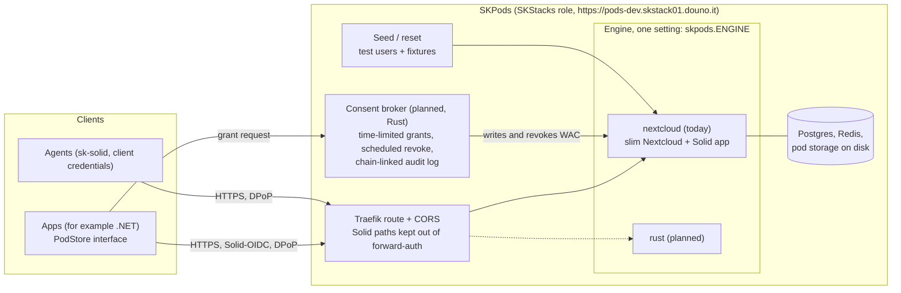
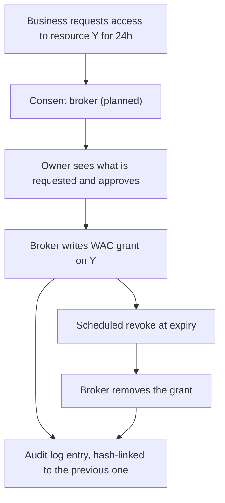
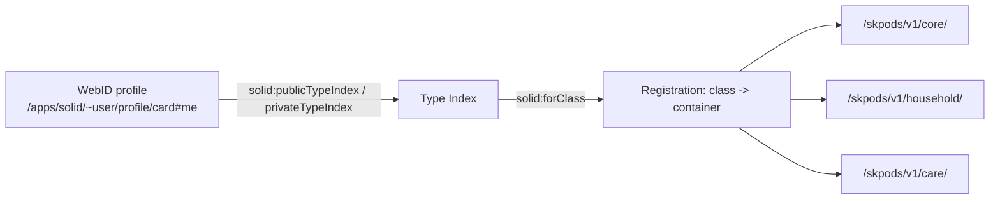

# SKPods: Standard Operating Procedures

SKPods hosts Solid pods for any app and for anyone running their own instance. Protocols: Solid Protocol, Solid-OIDC, DPoP, WAC, WebID, Type Indexes, Solid Notifications. Callers: apps (for example .NET apps through a `PodStore` interface) and headless agents.

Status: documentation and code stubs. The server is deployed from the SKStacks role, not from this repo. See [README.md](./README.md) for status labels.

## 1. Overview

**Purpose.** Give every person a Solid pod (a WebID plus personal storage). Apps keep no personal database: they read and write the user's pod with the user's consent and lose access when the user revokes it.

**This repo owns:**

- The architecture and operating documents (this file, [docs/ARCHITECTURE.md](./docs/ARCHITECTURE.md)).
- Code stubs under [sdk/](./sdk/dotnet/): .NET `PodStore`, Rust `sk-solid` skeleton, raw HTTP examples.
- The developer guides: [GETTING-STARTED](./docs/GETTING-STARTED.md), [LOGIN-AND-AUTH](./docs/LOGIN-AND-AUTH.md), [TEST-ACCOUNTS](./docs/TEST-ACCOUNTS.md).

**This repo does NOT:**

- Deploy anything. Deployment is the `skpods` role in [smilinTux/skstacks](https://github.com/smilinTux/skstacks).
- Hold credentials, vault values or real personal data.
- Contain the consent broker or the Rust engine (both Planned).
- Run Node.js anywhere. We do not use the Node.js Community Solid Server.

**Status table**

| Part | Status |
|---|---|
| `pods-dev` | Live since 2026-11-23 (verified: discovery, profiles, CORS, agent DPoP login, own-pod read/write, cross-pod 403) |
| SDK (.NET, Rust) | Stubs |
| Consent broker | Planned (Phase 3) |
| Rust engine | Planned (Phase 4) |

## 2. Architecture

Primary view: an app talks plain Solid HTTP with DPoP through the `PodStore` interface. Nothing in the app is engine-specific, so the engine behind the URL can change.



Consent flow (summary, full sequence in [docs/ARCHITECTURE.md](./docs/ARCHITECTURE.md)): the business asks, the owner approves, the broker writes a WAC grant with an expiry, revokes it on schedule, and appends every grant and revoke to a chain-linked audit log. The broker is Planned.



Example data layout in a pod (versioned path, found through the Type Index):



Pod URL shape on the Nextcloud engine (verified against the SKStacks role SOP):

| Item | URL |
|---|---|
| Issuer | `https://<host>` |
| Discovery | `https://<host>/.well-known/openid-configuration` |
| WebID | `https://<host>/apps/solid/~<user>/profile/card#me` |
| Pod root (storage) | `https://<host>/apps/solid/~<user>/storage/` |
| Agent credentials | `POST https://<host>/apps/solid/client-credentials` |

**Start here** (entry-point files, in order):

1. [README.md](./README.md): hub and reading order.
2. [docs/ARCHITECTURE.md](./docs/ARCHITECTURE.md): components, dataflows, trust boundaries, scale-out.
3. [docs/LOGIN-AND-AUTH.md](./docs/LOGIN-AND-AUTH.md): how to authenticate.
4. [sdk/dotnet/](./sdk/dotnet/): the `PodStore` interface.

## 3. Build

This repo has no build for the server. What exists:

| Artifact | How to produce | Status |
|---|---|---|
| Docs | None. Markdown, mermaid renders on GitHub. | Working |
| .NET stubs | `dotnet build` in [sdk/dotnet/](./sdk/dotnet/) (needs the .NET SDK) | Stub |
| Rust skeleton | `cargo build` in [sdk/rust/sk-solid/](./sdk/rust/sk-solid/) (needs Rust) | Stub |
| Engine image | Built from source by our CI, not here. One image `skpods-nextcloud:<nc-version>-solid-<sha>`, pinned by digest. | Working in CI |

The engine image is the official Nextcloud image plus the Solid app built from source. We never use the Nextcloud app store build. Rollback is pinning the previous digest.

## 4. Test

| Check | Command | Status |
|---|---|---|
| Docs gate | `python3 <path-to-sk-standards>/scripts/docs_check.py --repo .` | Working |
| Conformance gate (Solid test harness plus SKPods permission scenarios) | See [docs/CONFORMANCE.md](./docs/CONFORMANCE.md) | Planned (Phase 2) |
| Smoke test of a live server | Discovery request below | Working once `pods-dev` is live |

```bash
curl -s https://pods-dev.skstack01.douno.it/.well-known/openid-configuration
# expect "issuer": "https://pods-dev.skstack01.douno.it"
```

The release gate for the engine: it does not replace the current one until it passes at least as many conformance features, and standard Solid apps (Penny, the SolidOS data browser) still log in and work.

## 5. Release / Deploy

**Front-end / Exposure:** Tier 2, SKStacks/Traefik. Public `:443` routes on the pods host: `/.well-known/openid-configuration`, `/.well-known/solid`, `/apps/solid/{authorize,token,register,jwks,userinfo,logout}`, `/apps/solid/~*/profile/*`, `/apps/solid/~*/storage/*`, `/apps/solid/client-credentials`. The engine listens only on the swarm ingress network, never on a public port.

**Libraries and docs in this repo:** version bump, entry in [CHANGELOG.md](./CHANGELOG.md), tag `vX.Y.Z`. The SDK stubs are not published to any package registry yet.

**The server is deployed by the SKStacks role, at a release tag.** Rules:

1. Deploy through the `skpods` role (`v1/ansible/optional/skpods` in [smilinTux/skstacks](https://github.com/smilinTux/skstacks)) checked out at a release tag (for example `skstacks-v2.26.33`). Never deploy from an untagged framework checkout.
2. Use your own vault values (hostname, cluster, domain, engine image digest, admin and database secrets). They are yours; nothing here supplies them.
3. Use the per-environment playbooks: `deploy_skpods-dev.yml`, `deploy_skpods-staging.yml`, `deploy_skpods-prod.yml`. Same code in every environment, different values.
4. Run check mode first, then apply.

```bash
ansible-playbook -i <inventory> framework/v1/ansible/optional/skpods/deploy_skpods-<env>.yml \
  -e target_manager_group=<managers> -e skstacks_vault_dir=<instance vault root> \
  --vault-password-file <password file> --check --diff
# then the same command without --check --diff
```

**Hostname is permanent.** Each pod's root ACL records the owner's full WebID as an absolute URL. Set the public hostname and https settings before the first pod is used. Changing hostname, cluster or domain afterwards locks owners out of their pods (on dev, reset all users after a change).

**Rollback.** Change `NEXTCLOUD_IMAGE` to the previous digest and rerun the deploy. Rolling back across a Nextcloud major version is not supported by Nextcloud.

**Seed and reset (dev only).** Test users and fixture data are recreated by the role's `seed` tag. `pods-dev` holds fake data only and is resettable on request. `manolo` (the app developer's dev account) is not reset.

**Engine switch (Planned).** The engine is selected by one setting, `skpods.ENGINE`. Today only `nextcloud` is implemented and the deploy refuses any other value. The Rust engine is selected the same way, only after it passes the same conformance gate.

## 6. Configuration / Usage

Server configuration lives in the SKStacks role vault, not in this repo. Main keys (full table in the role README):

| Key | Meaning |
|---|---|
| `ENGINE` | Engine selector (`skpods.ENGINE`). Only `nextcloud` today. |
| `CLUSTERNAME`, `DOMAIN`, `HOST_PREFIX` | Build the hostname `<HOST_PREFIX>[-<env>].<cluster>.<domain>`. |
| `NEXTCLOUD_IMAGE` | Engine image as `repo:tag@sha256:<digest>`. Required. |
| `ADMIN_PASSWORD`, `DB_PASSWORD` | Secrets, 16+ characters, set by the operator. Never in git. |

**Client configuration** (for your app and agents):

| Variable | Meaning |
|---|---|
| `SKPODS_ISSUER` | `https://pods-dev.skstack01.douno.it` for dev. |
| `SKPODS_CLIENT_ID`, `SKPODS_CLIENT_SECRET` | Agent credentials. Delivered privately by the SKPods admin. Never commit them. |
| `SKPODS_APP_PASSWORD` | Used only to mint agent credentials. Delivered privately. Never commit it. |

Credentials, test-account passwords and app passwords are delivered privately by the SKPods admin. Read them from environment variables or a local secret store. See [SECURITY.md](./SECURITY.md).

## 7. API / Reference

Apps use plain Solid HTTP (GET, PUT, PATCH, DELETE on resources, `Authorization: DPoP <token>` plus a `DPoP` proof header). Nothing engine-specific.

| Need | Where |
|---|---|
| Login flows, DPoP, client credentials | [docs/LOGIN-AND-AUTH.md](./docs/LOGIN-AND-AUTH.md) |
| Raw HTTP examples | [sdk/http/](./sdk/http/) |
| `PodStore` interface | [sdk/dotnet/](./sdk/dotnet/) |
| Access control and consent | [docs/ACCESS-AND-CONSENT.md](./docs/ACCESS-AND-CONSENT.md) |
| Test users | [docs/TEST-ACCOUNTS.md](./docs/TEST-ACCOUNTS.md) |

Spec references: [Solid Protocol](https://solidproject.org/TR/protocol), [Solid-OIDC](https://solidproject.org/TR/oidc), [WAC](https://solidproject.org/TR/wac), [Type Indexes](https://solid.github.io/type-indexes/), [Solid Notifications](https://solidproject.org/TR/notifications-protocol).

## 8. Troubleshooting

| Symptom | Check |
|---|---|
| Discovery URL returns an error or wrong `issuer` | Server down or being redeployed, or hostname settings differ from the public URL. Ask the SKPods admin. |
| Browser app blocked by CORS | Is the request going to the pods host and not a different origin path? The edge answers CORS on `/apps/solid/*` and `/.well-known/*`. |
| `401` on a resource | Token missing, expired (agent tokens last one hour), or DPoP proof not matching the method and URL. See [docs/LOGIN-AND-AUTH.md](./docs/LOGIN-AND-AUTH.md). |
| `403` on a resource | You are authenticated but the owner has not granted your WebID access. Check the WAC `.acl` and [docs/ACCESS-AND-CONSENT.md](./docs/ACCESS-AND-CONSENT.md). |
| `404` on `/skpods/v1/...` | The container does not exist yet in that pod, or you are on the wrong pod URL. Pod paths use `~<user>`. |
| Test data looks wrong or stale | `pods-dev` is resettable. Ask the SKPods admin for a reset. |
| Owner locked out after a deploy change | Hostname changed after pods existed. See "Hostname is permanent" in section 5. |
| Deploy refuses an engine value | Only `nextcloud` is implemented. |

## 9. Maturity-tier + Version reference

- Maturity tier: T0, N/A (no key material generated or held here). Not a crypto component.
- Phase: Incubating v0.
- SemVer: 0.1.0 (see [CHANGELOG.md](./CHANGELOG.md)).
- Honest claims: every part labelled Stub, Planned or Designed is not working software. Only the SKStacks role and the engine image build exist today, and `pods-dev` is live.

<!-- docs-evidence
verified: 2026-11-23
checks:
  - name: readme exists
    run: test -f README.md
  - name: sop names the role path
    run: grep -q 'v1/ansible/optional/skpods' SOP.md
  - name: dev url documented
    run: grep -q 'pods-dev.skstack01.douno.it' SOP.md
  - name: no em or en dashes
    run: "! grep -nP '\\x{2014}|\\x{2013}' SOP.md"
-->
