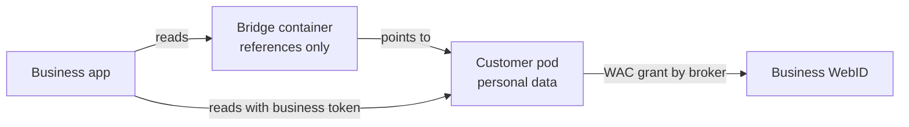
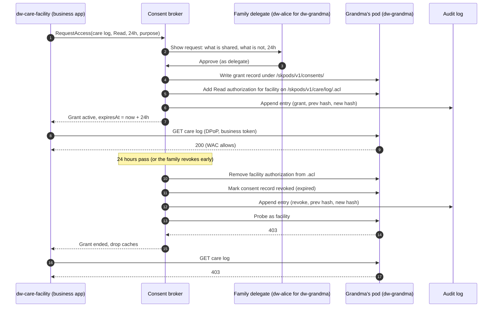

# Access and consent model

> Status legend used in this file: **Working** (runs today on pods-dev), **Designed** (decided, not built),
> **Planned** (on the phase plan, no design detail yet). pods-dev is live since 2026-11-23.

This is the security and consent model for SKPods and the apps that sit on it. It tells you who
can be an identity, how access is expressed in a pod, how time-limited access is added on top of the
protocol, and what a business keeps after access ends. Read [ARCHITECTURE.md](./ARCHITECTURE.md) for the
overall picture and [LOGIN-AND-AUTH.md](./LOGIN-AND-AUTH.md) for how to sign in.

## 1. Summary for an AI agent reading this

- Every person, business and agent is a WebID. Access is granted to WebIDs, never to usernames.
- Access control today is **WAC** (`.acl` files in Turtle). It is **Working** on the Nextcloud engine.
- WAC has no expiry. The **consent broker** (**Designed**, Rust, phase 3) adds time limits by writing the grant,
  recording it, and revoking it on schedule.
- Apps never write `.acl` files themselves in production. They ask the broker (one interface, section 8).
- Businesses get references and time-limited reads. Personal data stays in the person's pod.
- Card numbers and raw payment data never go into a pod. Processor references only.
- Every grant and revoke is written to a hash-chained audit log.

## 2. Identities

| Identity | WebID shape on the Nextcloud engine | Who it is |
|---|---|---|
| Person | `https://<host>/apps/solid/~<user>/profile/card#me` | One WebID per human. Owns one pod. |
| Business | same shape, a user account that represents the business | The business as a legal actor, for example `dw-care-facility`. |
| Agent | same shape, a user account used with client credentials | A headless process acting for a person or a business, for example `dw-agent`. |

The pod root for a user is `https://<host>/apps/solid/~<user>/storage/`. On pods-dev `<host>` is
`pods-dev.skstack01.douno.it`. (Pattern taken from the SKPods role docs and verified by the deploy check
script; a different engine may use different paths, so read the WebID from the token or the profile, never
build it from a username in app code.)

Rules:

1. **One WebID per person.** A household is a group of person WebIDs, not a shared account.
2. **A business has its own WebID**, separate from any staff member. Staff sign in as themselves and act for
   the business through the app (section 7). The business WebID is what appears in a customer's `.acl`.
3. **An agent has its own WebID.** It uses a client-credentials grant bound to that WebID. An agent never
   inherits the access of the person who created it. It sees only what it was granted (test account `dw-agent`).
4. **WebIDs are permanent.** The root `.acl` of each pod stores the owner's absolute WebID, so the hostname must
   never change once pods exist (see the role SOP, "Hostname is permanent").

## 3. WAC basics

WAC (Web Access Control) is an authorization model in the Solid Protocol. A resource's access is decided by
the nearest `.acl` resource: the one named by the resource's `Link: <...>; rel="acl"` header, or, if the
resource has none, the `.acl` of the closest parent container that has `acl:default` authorizations.

Modes: `acl:Read`, `acl:Write` (includes create and delete), `acl:Append` (add only), `acl:Control` (read and
write the `.acl` itself).

Subjects: `acl:agent` (one WebID), `acl:agentGroup` (members of a group document), `acl:agentClass foaf:Agent`
(everyone, anonymous included), `acl:agentClass acl:AuthenticatedAgent` (any signed-in WebID).

Targets: `acl:accessTo` (this resource) and `acl:default` (inherited by contained resources that have no own `.acl`).

### 3.1 Default: owner only

The root `.acl` of a pod, written when the pod is first used. Nothing else is readable by anyone.

```turtle
# https://pods-dev.skstack01.douno.it/apps/solid/~dw-alice/storage/.acl
@prefix acl: <http://www.w3.org/ns/auth/acl#>.

<#owner>
    a acl:Authorization;
    acl:agent <https://pods-dev.skstack01.douno.it/apps/solid/~dw-alice/profile/card#me>;
    acl:accessTo <./>;
    acl:default <./>;
    acl:mode acl:Read, acl:Write, acl:Control.
```

Apps must keep this default. Everything below adds a separate, narrower `.acl` on a sub-container.

### 3.2 Household group read

The household group is a document in the owner's pod. Members can read the household container; only the
owner can change it.

```turtle
# /skpods/v1/household/members.ttl
@prefix vcard: <http://www.w3.org/2006/vcard/ns#>.

<#household>
    a vcard:Group;
    vcard:hasMember
        <https://pods-dev.skstack01.douno.it/apps/solid/~dw-alice/profile/card#me>,
        <https://pods-dev.skstack01.douno.it/apps/solid/~dw-bob/profile/card#me>.
```

```turtle
# /skpods/v1/household/.acl
@prefix acl: <http://www.w3.org/ns/auth/acl#>.

<#owner>
    a acl:Authorization;
    acl:agent <https://pods-dev.skstack01.douno.it/apps/solid/~dw-alice/profile/card#me>;
    acl:accessTo <./>;
    acl:default <./>;
    acl:mode acl:Read, acl:Write, acl:Control.

<#household-read>
    a acl:Authorization;
    acl:agentGroup <https://pods-dev.skstack01.douno.it/apps/solid/~dw-alice/storage/skpods/v1/household/members.ttl#household>;
    acl:accessTo <./>;
    acl:default <./>;
    acl:mode acl:Read.
```

Partial sharing (spouse sees the calendar but not the finance folder) is the same pattern with a narrower
`acl:accessTo` target, for example `/skpods/v1/household/calendar/`. Test account: `dw-bob`.
**To verify on the Nextcloud engine:** `acl:agentGroup` support. If a scenario in
[CONFORMANCE.md](./CONFORMANCE.md) fails, the fallback is one `acl:agent` line per member, written by the same helper.

### 3.3 Time-limited business grant (written by the broker)

A business gets read access to one container. The authorization carries no expiry the server enforces. The
`skp:` annotations are informational for humans and for the broker's reconciler; the server ignores them.

```turtle
# /skpods/v1/care/log/.acl  (written by the consent broker, never by the business)
@prefix acl: <http://www.w3.org/ns/auth/acl#>.
@prefix skp: <https://w3id.org/skpods/v1#>.
@prefix xsd: <http://www.w3.org/2001/XMLSchema#>.

<#owner>
    a acl:Authorization;
    acl:agent <https://pods-dev.skstack01.douno.it/apps/solid/~dw-grandma/profile/card#me>;
    acl:accessTo <./>;
    acl:default <./>;
    acl:mode acl:Read, acl:Write, acl:Control.

<#grant-0f3a>
    a acl:Authorization;
    acl:agent <https://pods-dev.skstack01.douno.it/apps/solid/~dw-care-facility/profile/card#me>;
    acl:accessTo <./>;
    acl:default <./>;
    acl:mode acl:Read;
    skp:consent <https://pods-dev.skstack01.douno.it/apps/solid/~dw-grandma/storage/skpods/v1/consents/0f3a.ttl>;
    skp:expiresAt "2026-12-01T18:00:00Z"^^xsd:dateTime.
```

(The vocabulary IRI above is an example namespace for this document.)

A grant is always: one business WebID, one container, a list of modes (read in nearly every case), one
consent record. Never `acl:agentClass foaf:Agent` for personal data.

## 4. Why WAC has no expiry, and how the broker adds it

WAC answers one question: "is this WebID allowed this mode on this resource right now". The `.acl` file
has no time field, so a grant lasts until someone edits the file. For "give the care facility access for 24
hours" something has to remember to take it back. That something is the **consent broker** (**Designed**,
phase 3, written in Rust on the `sk-solid` library).

The broker does four things, in this order:

1. **Request.** A business asks for access: which resource, which modes, how long, why. The request lists
   what the business can and cannot see. The person (or their delegate, section 6) sees exactly that text.
2. **Grant record.** On approval the broker writes a grant record into the **grantor's own pod** under
   `/skpods/v1/consents/` (a Turtle or JSON-LD resource, owner-readable). It holds:
   grant id, grantor WebID, grantee WebID, resource IRIs, modes, purpose, `grantedAt`, `expiresAt`, who
   approved (the person or a named delegate), and the audit entry hash. The person can always list and read
   their own consents, with no app involved.
3. **Write the ACL.** The broker adds the matching authorization to the container's `.acl` (example 3.3).
   It does this with its own WebID, which holds `acl:Control` only on `/skpods/v1/` containers that the person
   delegated to it. It does not hold `Control` on the whole pod.
4. **Scheduled revoke.** At `expiresAt` the broker removes that one authorization, marks the consent record
   `revoked` with the reason (`expired`, `revoked-by-owner`, `revoked-by-delegate`), and writes the audit entry.
   A reconciler also runs on a timer: it scans `.acl` files for authorizations the broker owns and removes any
   that have no live consent record (covers a broker restart or a missed timer). Early revoke by the owner
   follows the same path.

Revoke is checked, not assumed: after removing the authorization the broker reads the resource as the
grantee's test identity (or an equivalent probe) and expects 403. A revoke that did not take effect is
retried and raises an alert.

### 4.1 Chain-linked audit log

Every grant, change and revoke is one entry. Each entry contains the SHA-256 hash of the previous entry,
so changing or deleting any past entry breaks every hash after it.

```json
{
  "seq": 42,
  "ts": "2026-11-30T18:00:00Z",
  "event": "grant",
  "grant": "0f3a",
  "grantor": "<WebID of grandma>",
  "grantee": "<WebID of the facility>",
  "approver": "<WebID of the delegate>",
  "resources": ["/skpods/v1/care/log/"],
  "modes": ["Read"],
  "expiresAt": "2026-12-01T18:00:00Z",
  "prev": "sha256:9c1e...",
  "hash": "sha256:b7d4..."
}
```

`hash = SHA-256(canonical JSON of the entry without "hash")`, with `prev` included in the input. Entry 0
uses a fixed genesis value. The log holds identifiers, resources, modes and times, not personal content.

- The broker keeps the authoritative chain in append-only storage it controls. It publishes the latest hash
  to a second place (for example a read-only file the operator can see) so a full rewrite is detectable.
- A copy of the entries that concern a person is mirrored into that person's pod
  (`/skpods/v1/consents/audit/`), owner-readable. Verifying a chain needs only the entries and the first hash.
- "Tamper-evident" means changes are detectable. It does not mean they are impossible.

Status: **Designed**. `sk-solid` already has stub commands for grant and revoke; the broker and the log are phase 3.

## 5. The bridge container

Each customer and business pair has one **bridge container** (a pattern any app can use). It
lets the business app work with a customer without holding the customer's data.

- **Where it lives:** on the business side (the business pod, `/skpods/v1/bridge/<customer-ref>/`), not in the customer's pod.
- **What it holds:** references only. The customer's WebID, the IRIs of the resources the customer granted,
  the consent record IRI, the expiry, and opaque business-side ids (customer number, booking id). It
  holds no names, no care notes, no addresses, no copies of the customer's data.
- **How the app uses it:** the app reads the bridge to find what it may open, then reads the customer's pod
  **with the business's own token**. WAC on the customer's pod decides. If the grant is gone, the read returns
  403 and the app shows the customer as unavailable.
- **On revoke or expiry:** the broker marks the bridge entry `revoked`, and the app removes anything it
  cached for that customer (section 10).



Status: **Designed**. The container shape is defined with the consent broker in phase 3.

## 6. Delegated control: minors and elders

A person who cannot manage their own pod is still a WebID with a pod. Someone else holds `acl:Control`.

| Case | Test accounts | Mechanism |
|---|---|---|
| Parent controls a minor | `dw-alice` controls `dw-kid` | The parent's WebID is on the child's root `.acl` with Read, Write, Control. The child's own WebID may be added later with fewer modes. The parent approves or denies consent requests for the child. |
| Power of attorney for an elder | `dw-grandma` and a family delegate (`dw-alice` in the fixtures, `skp:attorneyInFact`) | The delegate has Read, Write, Control on the elder's pod, under a record of the authority (who, scope, start, end, document reference) at `/skpods/v1/care/poa/`. |

Rules:

1. A delegation is itself a grant record in the broker's audit chain: who delegated, who received, scope, dates.
2. A delegate approves consent requests **as the delegate**. The audit entry names both the pod owner and the approver.
3. A delegation has an end condition. For a minor, a date (the age of majority or earlier) that triggers a review. For power of attorney, the end of the authority or the person's own revoke.
4. A delegate cannot widen their own authority. Adding a second delegate or changing scope needs the owner,
   or a legal-authority record when the owner cannot act.
5. The elder's care-log items stay in the elder's pod. Family members get read access (live family log) by
   grant, not by copying.
6. Location data and similar safety signals are off unless the person or their delegate turns them on.

A real power of attorney has legal limits. This model records and enforces the app side. Legal review of
the scope per jurisdiction is outside this repo.

## 7. Staff roles inside a business

Two layers, deliberately.

1. **Business pod, WAC groups (coarse).** Business-side roles map to group documents in the business pod,
   for example `/skpods/v1/org/groups/caregivers.ttl#g`, `.../managers.ttl#g`, `.../front-desk.ttl#g`. The
   business pod's `.acl` files grant those groups access to the business containers (rosters, schedules,
   internal notes). A staff member's WebID is a member of a group. Adding or removing staff edits the
   group, not every `.acl`.
2. **The app (fine).** The app enforces finer roles: which screen, which field, which action. It
   applies them after WAC has said yes. The app role table is the app team's; the pod is not a second
   permission system for every button.

Customer pods are different: a customer never grants a group. They grant the **business WebID** (section
3.3). The business app decides which staff may use that access, by its own roles. This keeps customer ACLs
short and stable when staff change. A business that wants only the caregiver on shift to read a log
implements that in the app, and the log of who read what stays in the business's own records.

Test accounts: `dw-care-facility` (business), `dw-practitioner` (business).

## 8. The broker interface (what an app calls)

Apps call a small interface and never edit ACLs directly. Sketch (the real stub is in
[`../sdk/`](../sdk/README.md)):

| Operation | Purpose |
|---|---|
| `RequestAccess(grantee, resources, modes, duration, purpose)` | Business asks. Returns a request id. |
| `Approve(requestId, approverWebId)` / `Deny(requestId, ...)` | Grantor or delegate decides. |
| `Revoke(grantId, reason)` | Early revoke. |
| `ListGrants(webId, status)` | Open, expired, revoked, per person or per business. |
| `Verify(grantId)` | Returns the chain entries and whether the chain is intact. |

The interface says nothing about WAC. That is what makes section 11 possible.

## 9. What never goes in a pod

- Card numbers, CVV, bank account numbers, raw payment data. Use the **processor's reference** (customer id,
  payment method id, receipt id) and nothing else. The processor holds the card data.
- Passwords, app passwords, client secrets, API keys, private keys.
- Anything the person did not put there or consent to. Staff-only notes about a customer belong on the business side.

### Data minimisation

- Ask for the smallest container and the shortest duration that does the job. A request for the whole pod is refused by the broker.
- Prefer a reference to a copy: link to the resource, do not duplicate it.
- Business apps keep no personal database for the data the person owns. They keep their own business
  records (invoices, schedules) and references into the pod.
- Location and health data are off by default and need their own explicit grant.
- Logs hold identifiers and event types, not content.

## 10. Revoke semantics: what the business keeps

After revoke or expiry:

| Business keeps | Business loses |
|---|---|
| Its own records: invoices, bookings, schedules, internal notes it wrote itself | Any read access to the person's pod, immediately (403) |
| The bridge **entry**, marked revoked, with no personal data | The ability to list or open the shared containers |
| Audit entries (identifiers, resources, times) | Access to anything created after revoke |
| Whatever it legitimately needs for law or accounting, held under its own policy | |

What a protocol cannot do: **reach into a business and delete copies already made while access was open.**
The model handles this with a rule the app team implements and the broker supports:

1. The app reads from the pod on demand and keeps no long-lived copy of data the person owns. A short cache
   is allowed only if it is dropped at the grant's `expiresAt`.
2. On revoke or expiry (the broker publishes it, and the app also checks `expiresAt` on every read), the app
   purges cached data and removes the customer from active views. This is the "revoking makes the data
   disappear from the business side" behaviour apps should offer.
3. Anything a business must retain by law is retained under that business's retention rule and policy,
   and the customer is told which.

Status: the contract is **Designed**. The app-side purge is the app team's to build and to test with the
scenarios in [CONFORMANCE.md](./CONFORMANCE.md).

## 11. Migration path: ACP and W3C access request and grant

WAC is the model the Nextcloud engine supports today. The plan keeps WAC out of the apps so the model can change.

- **ACP (Access Control Policy)**, a richer model in the Solid ecosystem, can express conditions in policies. The Rust engine
  may support it. Moving to it changes what the broker writes, not what the apps call.
- **W3C access request and grant** work (Solid Community Group, and the follow-on standards effort
  mentioned in [COMMUNITY.md](./COMMUNITY.md)) describes the consent flow as a standard. If it matures, the
  broker can speak it to other apps and wallets, while keeping the same internal interface (section 8).
- **Expiry in the standard.** If a standard way to express an expiring grant lands, the broker uses it and
  keeps its scheduled revoke as a safety net.

Rule: no app code may depend on `.acl` Turtle. The only code that writes ACL syntax lives in the broker and `sk-solid`.

## 12. Sequence: care facility requests 24h access, family approves, auto revoke



## 13. Status

| Piece | Status |
|---|---|
| WebID per user, owner-only default, `.acl` writes by the owner | **Working** on the Nextcloud engine |
| Client credentials for agents (DPoP) | **Working** |
| Household group and partial sharing with WAC | **Working**, group support to verify on the engine |
| Consent broker, grant records, scheduled revoke | **Designed**, phase 3 |
| Chain-linked audit log | **Designed**, phase 3 |
| Bridge container | **Designed**, shapes in phase 2 |
| Delegation records | **Designed** |
| ACP or access request and grant | **Planned**, behind the broker interface |

## Related projects / See also

- [ARCHITECTURE.md](./ARCHITECTURE.md): how the pieces fit.
- [LOGIN-AND-AUTH.md](./LOGIN-AND-AUTH.md): Solid-OIDC and client credentials.
- [TEST-ACCOUNTS.md](./TEST-ACCOUNTS.md): the `dw-*` accounts used above.
- [CONFORMANCE.md](./CONFORMANCE.md): the permission scenarios that test this model.
- [COMMUNITY.md](./COMMUNITY.md): where we align with Solid standards work.
- [Solid Protocol](https://solidproject.org/TR/protocol), [WAC](https://solidproject.org/TR/wac), [Solid-OIDC](https://solidproject.org/TR/oidc).
