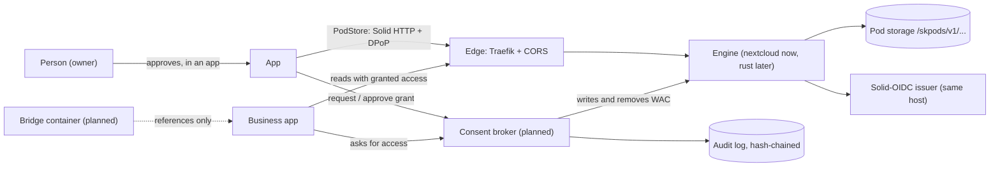
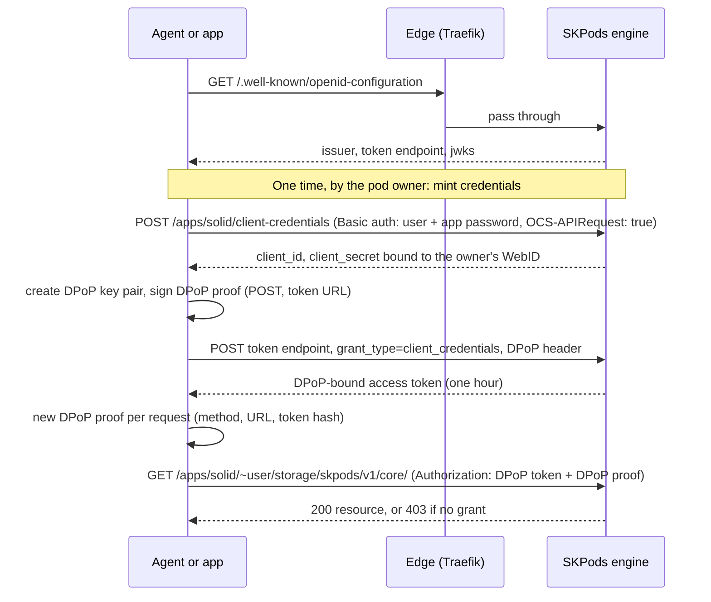
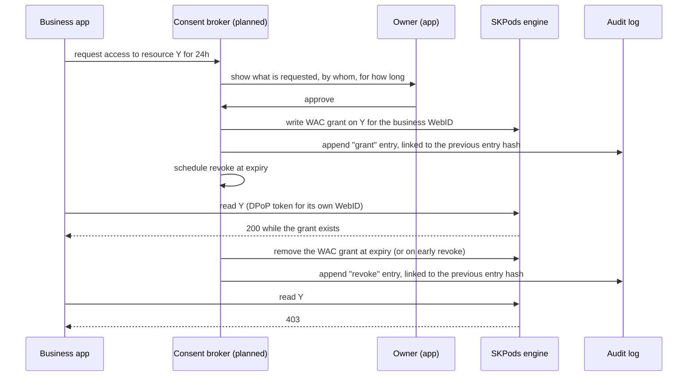

# SKPods architecture

Status: Designed. Parts marked Planned are not built. Operational detail is in [../SOP.md](../SOP.md); this file explains how the pieces fit and why.

## 1. Components

| Component | Role | Status |
|---|---|---|
| Apps (for example .NET) | Read and write the user's pod through a `PodStore` interface. Keep no personal database. | App side, outside this repo |
| `PodStore` + DPoP client | Plain Solid HTTP with DPoP. No engine-specific calls. | Stub, [../sdk/dotnet/](../sdk/dotnet/) |
| Edge (Traefik) | Public route, CORS, keeps Solid paths out of forward-auth. | Implemented in the SKStacks role |
| Engine: `nextcloud` | Slim standalone Nextcloud with only the pdsinterop Solid app. Solid-OIDC issuer, WebIDs, pod storage, WAC. Built from source by our CI, pinned by digest. | Working on `pods-dev` |
| Engine: `rust` | Same contract, different implementation. | Planned (Phase 4) |
| Consent broker (Rust) | Time-limited grants over WAC, scheduled revoke, chain-linked audit log. | Planned (Phase 3) |
| Bridge container | One per customer and business pair. Holds references only, never personal data. | Planned (app side) |
| Seed / reset | Recreates test users and fixture data. | Implemented in the role (`seed` tag); `sk-solid seed` Planned |
| `sk-solid` (Rust CLI and library) | Client credentials, DPoP token, get/put/patch/delete, grant and revoke, seed. Base for the Rust engine and broker. | Stub, [../sdk/rust/sk-solid/](../sdk/rust/sk-solid/) |
| Postgres, Redis, disk | Engine state and pod storage. | Implemented |

## 2. Dataflow

Data rule: personal data lives in the pod and nowhere else. Apps and bridges hold references (URLs, ids), not copies.

### 2.1 Login (agent, client credentials)

This is the flow verified end to end by our own checks. A browser user logs in with the Solid-OIDC authorization code flow against the same issuer ([../docs/LOGIN-AND-AUTH.md](./LOGIN-AND-AUTH.md)).

### 2.2 Consent grant (Planned: broker)

WAC grants do not expire on their own. That is why the broker owns time limits and revocation. The broker hides the access model behind one interface so we can move to ACP, or the W3C access request and grant work, without touching the apps.

## 3. Trust boundaries

| Boundary | Inside | Outside | Control |
|---|---|---|---|
| Public internet to edge | Traefik route | Any client | TLS; CORS on Solid paths; no forward-auth on Solid paths (clients authenticate with Solid-OIDC and DPoP) |
| Edge to engine | Swarm ingress network | Public | Engine has no public port |
| App to pod | Owner's data | Apps | Every request carries a DPoP-bound token; WAC decides per resource |
| Business to pod | Granted resources only | Everything else | Time-limited grant, revoked by the broker, every change logged |
| Bridge to business | References | Personal data | The bridge never holds personal data |
| Agent to pod | What the agent's WebID was granted | Everything else | Client credentials bound to one WebID, one-hour tokens, revocable |
| Operator to engine | Deploy, seed, reset | Tenants | Operators deploy with their own vault values; admin credentials never leave the operator |
| Test to real data | `pods-dev` fake users | Real people | `pods-dev` holds fake data only |

Credentials are delivered privately by the SKPods admin and are never committed to any repo. See [../SECURITY.md](../SECURITY.md).

## 4. Scale-out story

- **One setting swaps the engine.** `skpods.ENGINE` selects the implementation. Apps talk Solid HTTP and DPoP only, so changing the engine needs no app change. The Rust engine is used only after it passes the same conformance gate as the current one ([CONFORMANCE.md](./CONFORMANCE.md)). Today the deploy accepts only `nextcloud`.
- **Stateless app tier.** Apps and bridges keep no personal state. Add or remove instances freely; the pod is the state.
- **Per-environment instances from the same code.** The SKStacks role deploys `dev`, `staging` and `prod` from the same release tag with different values. Anyone can run an identical instance of their own.
- **`pods-dev` versus production.** `pods-dev` (`https://pods-dev.skstack01.douno.it`) holds fake data only and is resettable. Production (`https://pods.skstack01.douno.it`, Phase 4) never gets seeded fixtures. The hostname is fixed for the life of an environment, because each pod's root ACL records the owner's full WebID.
- **Engine scale limits.** The Nextcloud engine scales like Nextcloud (database, cache, storage). That is acceptable for the MVP; it is the reason the Rust engine is planned.

## 5. Extensibility

- **New data needs a schema change, not a backend change.** A new module is a new set of SHACL shapes and a JSON-LD context in your app, a new container under `/skpods/v1/<module>/`, and a Type Index registration. The engine stores any RDF resource.
- **New use cases are extra shape bundles.** A new use case ships shapes and fixtures only. No server work and no deploy.
- **Versioned paths.** `/skpods/v1/...` carries the version, so `v2` can live beside `v1` during a migration.
- **Discovery by Type Index.** Apps find data by class, never by hardcoded path.
- **Existing vocabularies first.** schema.org, vcard, FOAF and Solid terms are reused before anything new is defined.
- **Access model behind one interface.** WAC today; ACP or the W3C work later.

## 6. Related

- [../SOP.md](../SOP.md), [ACCESS-AND-CONSENT.md](./ACCESS-AND-CONSENT.md), [CONFORMANCE.md](./CONFORMANCE.md)
- [smilinTux/skstacks](https://github.com/smilinTux/skstacks), [pdsinterop/solid-nextcloud](https://github.com/pdsinterop/solid-nextcloud)
- [sk-standards](https://github.com/smilinTux/sk-standards) architecture and dataflow standard
