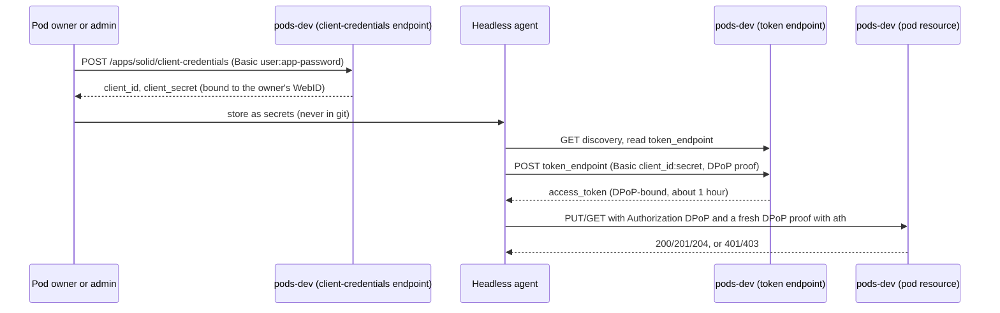
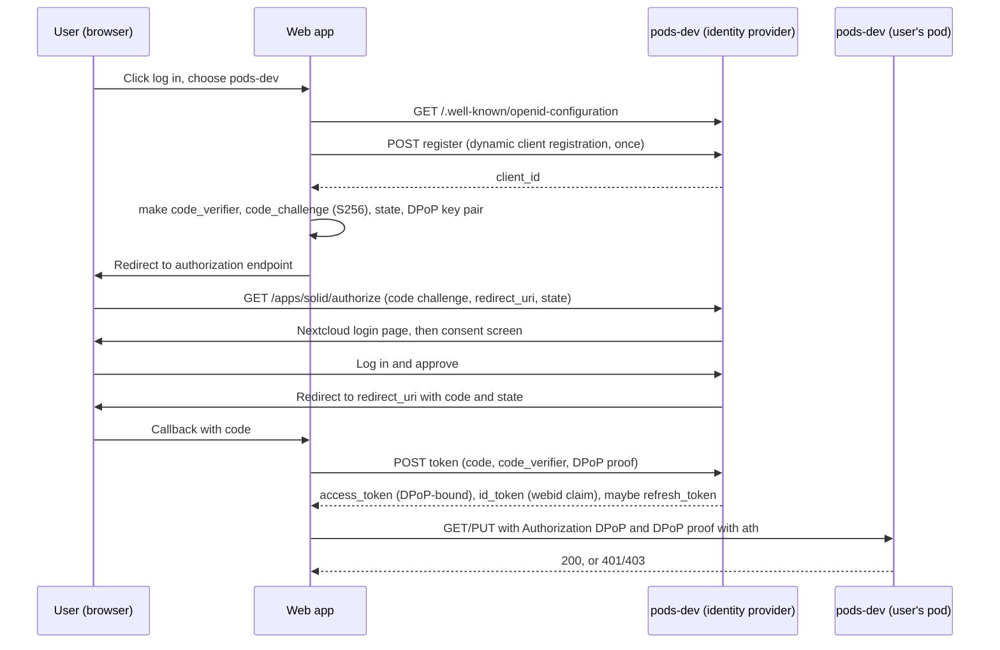

# Login and auth on SKPods

Status: pods-dev live since 2026-11-23. The client-credentials (agent) path below is verified end to end; the browser path follows the spec and is not yet exercised.
Maturity-tier: new (dev first)
Verified against: the role's own README and SOP (`v1/ansible/optional/skpods`) and a headless-agent smoke script that exercises paths 2 and the public reads. Path 1 (browser flow) follows the Solid-OIDC spec and has NOT been exercised end to end by us yet; every detail marked "verify on pods-dev" must be confirmed against the live discovery document.

Let `H=https://pods-dev.skstack01.douno.it`. The server is its own Solid-OIDC identity provider: the issuer is `H` itself.

## The three login paths

| # | Who | How | Use it for | Status |
|---|---|---|---|---|
| 1 | A person in a browser | Solid-OIDC authorization code + PKCE + DPoP | Web apps and customer-facing apps | Spec flow, verify on pods-dev |
| 2 | A headless agent or backend job | Client credentials + DPoP (the `dw-agent` pattern) | The AI receptionist, background jobs, tests | Working (smoke-tested) |
| 3 | A person administering their own pod | Nextcloud web UI login | Looking at your pod's files, creating app passwords | Working |

## Endpoints

Always read endpoints from discovery rather than hardcoding them.

| Purpose | URL | Source |
|---|---|---|
| Discovery | `H/.well-known/openid-configuration` | Verified |
| Solid server hint | `H/.well-known/solid` | Listed in role docs, content verify on pods-dev |
| Authorization | `H/apps/solid/authorize` | Role docs |
| Token | `H/apps/solid/token` (script reads `token_endpoint` from discovery and falls back to this) | Verified |
| Dynamic client registration | `H/apps/solid/register` | Role docs |
| JWKS | `H/apps/solid/jwks` | Role docs |
| Userinfo | `H/apps/solid/userinfo` | Role docs |
| Logout | `H/apps/solid/logout` | Role docs |
| Mint or revoke client credentials | `H/apps/solid/client-credentials` | Verified |
| WebID | `H/apps/solid/~<user>/profile/card#me` | Verified |
| Pod root | `H/apps/solid/~<user>/storage/` | Verified |
| Nextcloud web UI | `H/` | Role docs |

## DPoP proofs (used by paths 1 and 2)

A DPoP proof is a short-lived JWT you sign with a private key you hold. The access token is bound to that key. Every request needs its own proof.

Header:

```json
{ "typ": "dpop+jwt", "alg": "ES256", "jwk": { "kty": "EC", "crv": "P-256", "x": "<b64url>", "y": "<b64url>" } }
```

Claims:

| Claim | Value |
|---|---|
| `htm` | HTTP method of this request, upper case (`GET`, `POST`, `PUT`) |
| `htu` | The full request URL as sent: scheme, host, path. No query string, no fragment. Must match the URL you actually call, including the `https://` and the host. |
| `iat` | Current time, integer seconds. Keep your clock correct (NTP). |
| `jti` | A new unique id per proof (a UUID) |
| `ath` | Only on resource requests (not on the token request): base64url of the SHA-256 of the access token string |

Rules of thumb:

- Generate the key pair once per client session and keep it for the life of the token. The token carries `cnf.jkt`, the thumbprint of that key. A proof signed with a different key is rejected.
- One new proof per request. Never reuse a `jti`.
- Token request: `DPoP` header only. Resource request: `Authorization: DPoP <access_token>` plus a `DPoP` header whose proof includes `ath`. Do not send `Authorization: Bearer`.
- Whether the server demands or issues a `DPoP-Nonce`: verify on pods-dev. If a `401` carries a `DPoP-Nonce` header, retry once with that value as the `nonce` claim.

## Path 2: headless agent (client credentials + DPoP)

This is the `dw-agent` pattern. A person with a Nextcloud account makes an app password, trades it once for a Solid `client_id` and `client_secret` bound to their WebID, and the agent then uses only the client credentials.



### Minting client credentials

Needs the Nextcloud user name and an app password (created in the Nextcloud web UI under your account settings, Security, Devices and sessions, "Create new app password"; exact menu names in the slim app set: verify on pods-dev).

```http
POST /apps/solid/client-credentials HTTP/1.1
Host: pods-dev.skstack01.douno.it
Authorization: Basic base64(<USER>:<APP_PASSWORD>)
OCS-APIRequest: true
Content-Type: application/json

{"name": "my agent"}
```

Response (JSON), as seen on pods-dev 2026-11-23: `client_id`, `client_secret`, `client_name`, `grant_types`, `token_endpoint_auth_method`, `issuer` and `webid`. The credentials act as the user's WebID. Store the secret like a password.

```bash
curl -fsS -u "$SKPODS_USER:$SKPODS_APP_PASSWORD" \
  -H 'OCS-APIRequest: true' -H 'Content-Type: application/json' \
  -d '{"name":"my agent"}' "$SKPODS_BASE/apps/solid/client-credentials"
```

Revoke: `DELETE H/apps/solid/client-credentials/<client_id>` with the same Basic auth and header. Rotate by minting a new pair first, switching the agent, then revoking the old one.

### Token request

```http
POST /apps/solid/token HTTP/1.1
Host: pods-dev.skstack01.douno.it
Authorization: Basic base64(<CLIENT_ID>:<CLIENT_SECRET>)
Content-Type: application/x-www-form-urlencoded
DPoP: <proof: htm=POST, htu=https://pods-dev.skstack01.douno.it/apps/solid/token, iat, jti, no ath>

grant_type=client_credentials&scope=webid
```

Response (JSON): `access_token` (a JWT), `token_type` (pods-dev returns `Bearer`, but the token is DPoP-bound: always send it as `Authorization: DPoP <token>` with a proof), `expires_in` (3600, one hour). The access token carries `cnf.jkt` (your key's thumbprint) and a `webid` claim equal to the owner's WebID. No refresh token for this grant: ask again before expiry (refresh at about 50 minutes, keep the same key).

### Calling a resource

```http
PUT /apps/solid/~dw-agent/storage/skpods/v1/hello.ttl HTTP/1.1
Host: pods-dev.skstack01.douno.it
Authorization: DPoP <access_token>
DPoP: <proof: htm=PUT, htu=https://pods-dev.skstack01.douno.it/apps/solid/~dw-agent/storage/skpods/v1/hello.ttl, iat, jti, ath>
Content-Type: text/turtle

<#it> <http://schema.org/name> "hello" .
```

Expect 200, 201 or 204. `GET` with `Accept: text/turtle` returns 200. `DELETE` returns 200 or 204. Whether the server creates missing parent containers on a deep PUT: verify on pods-dev (if you get 404, PUT the container first). Conditional writes (`If-Match`, `If-None-Match`) and `PATCH` with N3 Patch or SPARQL Update: verify on pods-dev.

A scope of `webid` is what our smoke test uses. Other scopes: verify on pods-dev.

### Reference script (headless agent)

Python 3 with `pip install pyjwt cryptography requests`. Reads credentials from the environment, prints only PASS or FAIL lines. Save as `solid_check.py`. This is a test aid, not production code.

```python
#!/usr/bin/env python3
"""Smoke check against a Solid pod server: client_credentials + DPoP.
Env: SKPODS_BASE, SKPODS_USER, SKPODS_CLIENT_ID, SKPODS_CLIENT_SECRET
Usage: solid_check.py --other dw-alice
"""
import argparse, base64, hashlib, json, os, sys, time, uuid
from urllib.parse import urlsplit
import jwt, requests
from cryptography.hazmat.primitives.asymmetric import ec

ap = argparse.ArgumentParser()
ap.add_argument("--other", required=True, help="another user whose private area must be denied")
a = ap.parse_args()
base = os.environ["SKPODS_BASE"].rstrip("/")
host = urlsplit(base).netloc
me = os.environ["SKPODS_USER"]
cid, secret = os.environ["SKPODS_CLIENT_ID"], os.environ["SKPODS_CLIENT_SECRET"]
ok = True

def check(name, cond, detail=""):
    global ok
    ok &= bool(cond)
    print(f"[{'PASS' if cond else 'FAIL'}] {name} {detail}")

key = ec.generate_private_key(ec.SECP256R1())
n = key.public_key().public_numbers()
b64 = lambda b: base64.urlsafe_b64encode(b).rstrip(b"=").decode()
jwk = {"kty": "EC", "crv": "P-256", "x": b64(n.x.to_bytes(32, "big")), "y": b64(n.y.to_bytes(32, "big"))}

def dpop(method, url, token=None):
    c = {"htm": method, "htu": url, "iat": int(time.time()), "jti": str(uuid.uuid4())}
    if token:
        c["ath"] = b64(hashlib.sha256(token.encode()).digest())
    return jwt.encode(c, key, algorithm="ES256", headers={"typ": "dpop+jwt", "jwk": jwk})

r = requests.get(base + "/.well-known/openid-configuration", timeout=30)
conf = r.json() if r.ok else {}
check("discovery", r.status_code == 200 and conf.get("issuer") == base, f"issuer={conf.get('issuer')}")

other_webid = f"{base}/apps/solid/~{a.other}/profile/card#me"
r = requests.get(other_webid.split("#")[0], headers={"Accept": "text/turtle"}, timeout=30)
check("webid profile (other user, https IRIs)", r.status_code == 200 and other_webid in r.text, f"HTTP {r.status_code}")

origin = "https://app.example.org"
r = requests.options(f"{base}/apps/solid/~{a.other}/storage/", timeout=30, headers={
    "Origin": origin, "Access-Control-Request-Method": "GET",
    "Access-Control-Request-Headers": "authorization, dpop"})
check("cors preflight", r.status_code in (200, 204) and r.headers.get("Access-Control-Allow-Origin") in (origin, "*"), f"HTTP {r.status_code}")

tok_ep = conf.get("token_endpoint") or base + "/apps/solid/token"
r = requests.post(tok_ep, auth=(cid, secret), data={"grant_type": "client_credentials", "scope": "webid"},
                  headers={"DPoP": dpop("POST", tok_ep)}, timeout=30)
t = r.json() if "json" in r.headers.get("content-type", "") else {}
token = t.get("access_token")
check("token (client_credentials + DPoP)", r.status_code == 200 and token, f"HTTP {r.status_code} type={t.get('token_type')} expires_in={t.get('expires_in')}")
if not token:
    sys.exit(1)

def call(method, path, **kw):
    h = kw.pop("headers", {})
    h["Authorization"] = f"DPoP {token}"
    h["DPoP"] = dpop(method, base + path, token)
    return requests.request(method, base + path, headers=h, allow_redirects=False, timeout=30, **kw)

res = f"/apps/solid/~{me}/storage/check-{int(time.time())}.ttl"
r = call("PUT", res, data='<#it> <http://schema.org/name> "check" .\n', headers={"Content-Type": "text/turtle"})
check("write own pod", r.status_code in (200, 201, 204), f"PUT -> {r.status_code}")
r = call("GET", res, headers={"Accept": "text/turtle"})
check("read own pod", r.status_code == 200 and "check" in r.text, f"GET -> {r.status_code}")
r = call("DELETE", res)
check("delete own resource", r.status_code in (200, 204), f"DELETE -> {r.status_code}")
r = call("GET", f"/apps/solid/~{a.other}/storage/private/")
check("other user's private storage denied", r.status_code == 403, f"GET -> {r.status_code}")
r = requests.get(f"{base}/apps/solid/~{me}/storage/private/", timeout=30)
check("anonymous read of own private storage denied", r.status_code in (401, 403), f"GET -> {r.status_code}")
print("RESULT:", "ALL PASS" if ok else "FAILURES")
sys.exit(0 if ok else 1)
```

The same flow in .NET is stubbed in [../sdk/dotnet/](../sdk/dotnet/) and as raw HTTP in [../sdk/http/](../sdk/http/).

## Path 1: browser user login (Solid-OIDC, auth code + PKCE + DPoP)

For web apps and customer-facing apps. The user logs in at their own pod's identity provider (here `H`), and the app receives tokens that carry the user's WebID. The app then calls the user's pod with DPoP.

Use a maintained Solid-OIDC client library where one exists for your stack instead of hand-rolling this. The requests below show what happens on the wire, so you can debug it. Dynamic registration, the exact scopes and whether public Client ID documents are accepted: verify on pods-dev.



### 1. Register the client (once per app and redirect URI)

```http
POST /apps/solid/register HTTP/1.1
Host: pods-dev.skstack01.douno.it
Content-Type: application/json

{
  "application_type": "web",
  "client_name": "Example web app (dev)",
  "redirect_uris": ["https://localhost:5001/auth/callback"],
  "grant_types": ["authorization_code", "refresh_token"],
  "response_types": ["code"],
  "token_endpoint_auth_method": "none"
}
```

Use the registration URL from discovery (`registration_endpoint`). Response: `client_id` (a public client, no secret). Whether the server also accepts a Client ID Document URL as the `client_id`: verify on pods-dev. Registered redirect URIs must match exactly.

### 2. Authorization request (browser redirect)

```
GET /apps/solid/authorize
  ?response_type=code
  &client_id=<CLIENT_ID>
  &redirect_uri=https%3A%2F%2Flocalhost%3A5001%2Fauth%2Fcallback
  &scope=openid%20webid%20offline_access
  &state=<RANDOM>
  &code_challenge=<BASE64URL(SHA256(code_verifier))>
  &code_challenge_method=S256
  &prompt=consent
```

`code_verifier` is 43 to 128 random URL-safe characters. Keep it and `state` server-side or in session storage. The user sees the Nextcloud login page, then the consent screen. The callback arrives as `redirect_uri?code=...&state=...`. Check `state` before anything else.

### 3. Token request

```http
POST /apps/solid/token HTTP/1.1
Host: pods-dev.skstack01.douno.it
Content-Type: application/x-www-form-urlencoded
DPoP: <proof: htm=POST, htu=token endpoint URL, iat, jti>

grant_type=authorization_code&code=<CODE>&redirect_uri=<SAME_AS_ABOVE>&client_id=<CLIENT_ID>&code_verifier=<CODE_VERIFIER>
```

Response: `access_token` (DPoP-bound, `cnf.jkt`), `id_token` (read the `webid` claim: that is who logged in), `token_type` `DPoP`, `expires_in`. Refresh token only if `offline_access` is granted: verify on pods-dev. Access token lifetime for this flow: verify on pods-dev (the client-credentials token is one hour).

Refresh: same endpoint, `grant_type=refresh_token&refresh_token=<RT>&client_id=<CLIENT_ID>` with a fresh DPoP proof.

### 4. Call the pod

Identical to path 2, "Calling a resource". The WebID in the token must be the owner, or a WebID the owner granted access via WAC.

### CORS for browser apps

A browser app on another origin sends a preflight first. The Solid app answers CORS and `OPTIONS` itself on `/apps/solid/*` and `/.well-known/*`, and the edge deliberately adds no `Access-Control-*` headers of its own.

```bash
curl -si -X OPTIONS -H 'Origin: https://app.example.org' \
  -H 'Access-Control-Request-Method: GET' \
  -H 'Access-Control-Request-Headers: authorization, dpop' \
  $SKPODS_BASE/apps/solid/~dw-alice/storage/ | grep -i '^access-control'
```

Verified on pods-dev 2026-11-23: the preflight returns 200, echoes your `Origin` in `Access-Control-Allow-Origin` with `Access-Control-Allow-Credentials: true`, allows `authorization`, `content-type`, `dpop`, `slug`, `link` and methods GET, PUT, POST, OPTIONS, DELETE, PATCH, and exposes `Link`, `Location`, `ETag`, `WAC-Allow`, `WWW-Authenticate`, `Accept-Patch`, `Accept-Post` and `Updates-Via`.

## Path 3: Nextcloud web UI (admin of your own pod)

Open `H/` and sign in with your Nextcloud user name and password. You see the Files of your own account; your pod is the `solid/` folder. Use this to look at what the app wrote, to create an app password for path 2, and to change your own password. You cannot see other users' pods. This is not an app integration path: apps never call the Nextcloud UI or WebDAV.

Two-factor login and the app store are off on this server.

## Token and credential lifetimes

| Item | Lifetime |
|---|---|
| Client-credentials access token | 1 hour (role SOP) |
| DPoP proof | Seconds. Generate a new one per request. |
| Authorization code (path 1) | Verify on pods-dev; use it immediately |
| Browser-flow access and refresh tokens | Verify on pods-dev |
| `client_id` and `client_secret` | Until revoked, or until a reset recreates the user (dev) |
| App password | Until revoked in the web UI |

## Expected responses

| Situation | Response |
|---|---|
| Discovery | `200` JSON, `issuer` = base URL |
| Public profile or public root listing | `200` text/turtle |
| Token request OK | `200` JSON with `access_token` |
| Own pod, valid token, read or write | `200`, `201` or `204` |
| Another user's private area, valid token, no grant | `403` |
| Own private area, no token | `401` or `403` (both accepted by our check) |
| No pod resource at that path | `404` |
| Missing or invalid proof or token | `401` with a `WWW-Authenticate` header |

## Common errors

| Symptom | Cause | Fix |
|---|---|---|
| `401` on the token request | Wrong `client_id` or secret, or the credentials were revoked or reset | Mint a new pair |
| `400 invalid_request` or `invalid_dpop_proof` on token request | `htm`/`htu` mismatch, `htu` with a query string, wrong `typ`, missing `jwk`, stale `iat`, reused `jti` | Rebuild the proof exactly as the table above says; check the clock |
| `401` on a resource with a valid token | `Authorization: Bearer` instead of `DPoP`; proof missing `ath`; proof signed by a different key than the token's `cnf.jkt`; `htu` differs from the URL you called (http vs https, host, trailing slash) | Fix the proof |
| `401` after about an hour | Access token expired | Request a new token (client credentials) or refresh |
| `403` on your own pod | Token `webid` is not the pod owner, or the hostname changed after the pod was first used | Decode the token; ask the admin about a reset |
| `403` on someone else's data | No WAC grant for your WebID | Correct behaviour; ask the owner to grant it (see [ACCESS-AND-CONSENT.md](./ACCESS-AND-CONSENT.md)) |
| Redirect loop or `invalid redirect_uri` in browser flow | `redirect_uri` not registered exactly | Register the exact URI |
| Browser CORS error | Origin not allowed, or the preflight is being answered by something other than the Solid app | Run the `OPTIONS` check above; tell the admin |
| WebID or storage IRIs in responses start with `http://` | Server proxy settings wrong | Tell the admin. Do not work around it. |

## Security notes for app builders

- Treat `client_secret`, access tokens, refresh tokens and app passwords as secrets: environment or secret store only, never logs, never git.
- Verify the `webid` claim of any token your backend receives, and never trust a WebID sent in a plain header or body.
- Keep the DPoP private key in memory (or a key store), never in the app database.
- Do not store personal data from pods in the app database. Keep references (resource URLs) only.

## Related projects / See also

- [GETTING-STARTED.md](./GETTING-STARTED.md), [TEST-ACCOUNTS.md](./TEST-ACCOUNTS.md)
- [ARCHITECTURE.md](./ARCHITECTURE.md), [ACCESS-AND-CONSENT.md](./ACCESS-AND-CONSENT.md), [CONFORMANCE.md](./CONFORMANCE.md)
- [../sdk/dotnet/](../sdk/dotnet/), [../sdk/http/](../sdk/http/)
- [Solid-OIDC](https://solidproject.org/TR/oidc), [RFC 9449 DPoP](https://www.rfc-editor.org/rfc/rfc9449), [RFC 7636 PKCE](https://www.rfc-editor.org/rfc/rfc7636)
