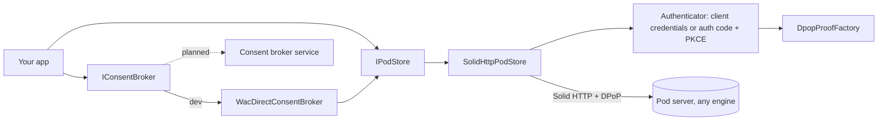

# SDK stubs

Status: **Stub**. Nothing here is a released library. The signatures are real
and the shapes are meant to survive; many bodies are `TODO`. Each stub says so at
the top of its source file.

## What is here

| Path | What | Status |
| --- | --- | --- |
| [`dotnet/`](dotnet/) | .NET 8 solution: `SKPods.Client` (library) and `SKPods.Client.Example` (console). `IPodStore`, `SolidHttpPodStore`, `DpopProofFactory`, `SolidOidcClientCredentials`, `SolidOidcAuthCode`, `IConsentBroker`, `WacDirectConsentBroker`, `PodStoreOptions`. | Stub. Client credentials, DPoP, GET/PUT/PATCH/DELETE are written but not yet built or tested here (no .NET SDK on the authoring machine). Auth code flow, Type Index lookup, Turtle parsing are `TODO`. |
| [`rust/sk-solid/`](rust/sk-solid/) | Rust crate (library and `sk-solid` CLI): `dpop`, `auth`, `pod`, `acl`, `seed`. | Stub. Passes `cargo check`; bodies are `todo!()`. Phase 2 tooling. |
| [`http/`](http/) | `examples.md` raw curl flow and `dpop.py` proof helper. | Reference. `dpop.py` runs; the curl flow mirrors the dev-server smoke check. |

## How they fit



The app codes against `IPodStore` and `IConsentBroker` only. `SolidHttpPodStore`
speaks plain Solid HTTP with DPoP, so nothing is tied to the Nextcloud engine and
the same code works when the Rust engine replaces it. `WacDirectConsentBroker`
is a dev stand-in: it writes `.acl` files itself, with no scheduled revoke and no
audit log. The real broker is planned (phase 3).

## Configuration

Environment variables only: `SKPODS_BASE`, `SKPODS_USER`, `SKPODS_WEBID`,
`SKPODS_CLIENT_ID`, `SKPODS_CLIENT_SECRET`. Credentials for the test accounts are
delivered privately by the SKPods admin. Never commit them.

Pod URL shape (verified against the dev tooling): WebID
`{base}/apps/solid/~{user}/profile/card#me`, pod root
`{base}/apps/solid/~{user}/storage/`. Example data paths live under `/skpods/v1/...`
with vocabulary namespace `https://w3id.org/skpods/v1#` (prefix `skp:`).

## Try it

```bash
# .NET (needs the .NET 8 SDK)
cd dotnet && dotnet build && dotnet run --project SKPods.Client.Example

# Rust
cd rust/sk-solid && cargo check

# curl: see http/examples.md
```

## Related projects / See also

- [../README.md](../README.md), [../docs/LOGIN-AND-AUTH.md](../docs/LOGIN-AND-AUTH.md), [../docs/TEST-ACCOUNTS.md](../docs/TEST-ACCOUNTS.md)
- [../docs/ACCESS-AND-CONSENT.md](../docs/ACCESS-AND-CONSENT.md), [../docs/ARCHITECTURE.md](../docs/ARCHITECTURE.md)
