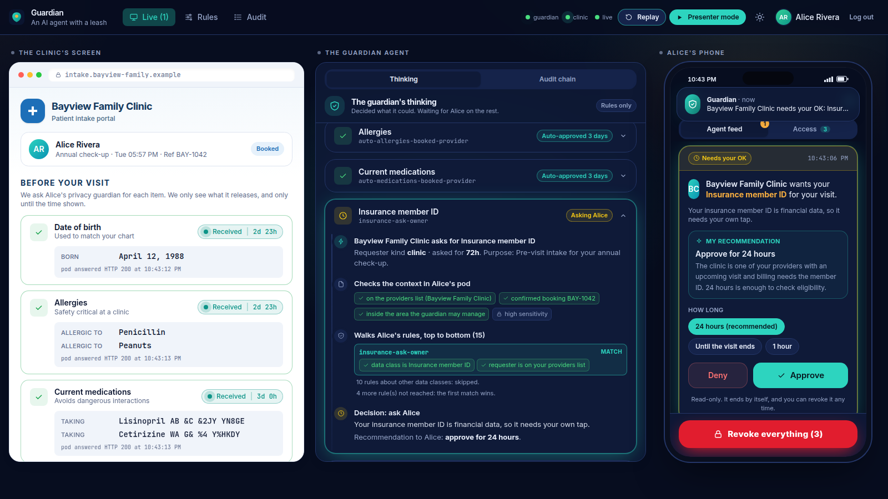

# Guardian: an AI agent with a leash

The flagship SKPods showcase. A clinic asks Alice for pre-visit data. Her guardian agent answers in seconds, by rules she wrote and keeps **in her own pod**: yes to some things, a tap for one, a firm no to the last. She sees everything live, can pull the plug with one button, and can verify the audit chain herself.



Video of the captioned auto-play (presenter mode, about two minutes): [docs/presenter-mode.webm](docs/presenter-mode.webm).

Screenshots in [docs/screenshots](docs/screenshots), all taken by the e2e test against pods-dev: `01-welcome`, `02-theatre-asking`, `03-approval-card`, `04-access-log`, `05-revoked`, `06-chain-verified`, `07-chain-tampered`, `08-policy-editor`, `09-replay-after-policy-change`, `10-llm-wording` (service started with an OpenAI-compatible endpoint), and at 390 px wide `phone-1-clinic`, `phone-2-guardian`, `phone-3-alice`, `phone-4-rules`.

## The story

Bayview Family Clinic (fictional, played by the account `dw-practitioner`) has a booked appointment with Alice Rivera (`dw-alice`) and asks for five things:

| Item | What the guardian does | Why |
|---|---|---|
| Date of birth | Auto-approves for 72 hours | Booked appointment, provider already on Alice's providers list |
| Allergies | Auto-approves for 72 hours | same |
| Current medications | Auto-approves for 72 hours | same |
| Insurance member ID | **Asks Alice.** A card slides onto her phone with a recommendation (approve, 24 h) and the reasoning. One tap | Financial data always needs a human |
| Social Security number | **Denies**, explains, and counter-offers the insurance ID | Never shared; the file is also owner-only in the pod, so even a buggy guardian could not hand it out |

Then: the clinic screen shows exactly what it received and when access ends (live countdowns), Alice's phone shows the live access log, **Revoke everything** ends every grant at once (the clinic's next read is HTTP 403), and the audit chain verifies, in the browser, against the service, and against the copy in Alice's pod.

## Three screens

- **Live** (the theatre). Left: the clinic's intake portal (what it asked, what it received, per field: waiting, received with countdown, declined, ended). Center: the guardian's thinking timeline (request, context checks against Alice's pod, every rule walked in order with its checks, the decision, the explanation, then everything that follows: owner tap, grant written, reads, revoke). Right: Alice's phone (agent feed, approval card, access tab, big red button). A second tab in the center shows the **audit chain**.
- **Rules** (policy editor). Per data class and per requester kind, three plain-language toggles: **Auto**, **Ask me**, **Never**, with the longest automatic duration. A live "in plain words" summary rewrites itself as you toggle. **Save to my pod** writes `skpods/v1/consents/policy.jsonld`, and the app asks the guardian service to read it back to prove it now follows the new version. **Replay the story** runs the scenario again so you see the effect on the very next request.
- **Audit**. The full chain, a verifier that sweeps it entry by entry, and a "simulate tampering" button that rewrites one recorded decision in a private copy and shows the chain breaking at exactly that entry.

### Presenter mode

The **Presenter mode** button auto-plays the whole story with captions, a spotlight on the panel being talked about, and a visible cursor that taps the real buttons (the clinic's Send, Alice's Approve, Revoke everything, Verify). Nothing is faked: the presenter clicks the same buttons a person would, so every call is real. Pause, skip ahead and exit are on the caption bar. `?present=1` starts it automatically after login. About two minutes.

## What is real and what is not

Real, against `https://pods-dev` with fake data:

- Browser **Solid-OIDC login** (authorization code + PKCE + DPoP through `@skpods/solid-web`), refresh handling.
- Alice's browser token is sent, DPoP-bound, to the **sk-consent** service for owner actions (approve, deny, revoke). The service verifies token and proof against the pod server's keys. This is the path the service README lists as "untested with a browser token": it works (see Evidence).
- Grants are real **WAC rules** written into Alice's pod and removed at expiry or revoke. The clinic's reads are real pod requests answering HTTP 200 or 403.
- The policy is a real file in Alice's pod, edited by Alice's browser and read by the guardian on every request.
- The audit chain is the service's hash chain; the verifier recomputes every SHA-256 in the browser (WebCrypto) and compares with the service and with the mirror written in Alice's pod.
- Live updates come from the service's server-sent events (the pod engine has no usable notifications, see `packages/solid-web/ENGINE-NOTES.md`).

Approximate or mocked, said plainly:

- **The clinic is a small Node process** (`scripts/clinic-bridge.ts`, localhost only) holding the practitioner account's client credentials. A browser tab cannot be logged in as two people, so the clinic's side (file a request, read the data, release) runs there. Every call it makes is real and authenticated, but it is a demo harness, not a clinic product.
- "Data read" entries in the audit log are **reported by the clinic's client**, not observed by the pod (pods do not push access logs). The log says so (`grantee-reported-authenticated`).
- The thinking timeline's **rule walk is a replay in the browser** of the same deterministic rules (`src/lib/policy.ts`, a TypeScript twin of the Rust engine). The service decides; the UI checks that its replay lands on the same rule id as the service and says so when it does not (for example if the rules were edited after the request).
- The LLM is optional and off by default. See below.
- The clinic website, Harborline Health insurer, names and numbers are fictional. The SSN is `000-00-0000`.

## LLM explanations (optional)

Set `GUARDIAN_LLM_BASE_URL` (any OpenAI-compatible `/v1`), `GUARDIAN_LLM_MODEL` and optionally `GUARDIAN_LLM_API_KEY` on the **service**. It then words a friendlier explanation of each decision, shown in the thinking timeline ("In plain words, worded by an LLM") and on Alice's phone. The rules decide; the LLM never changes an outcome, and a failure or timeout simply leaves the explanation out. The UI shows "Rules only" or "LLM wording on" from the service's `/healthz`.

## Run it

Prerequisites: Node 22, a Rust toolchain (for the service), the pods-dev test credentials (never commit them).

```bash
cd showcase && npm install

# 1. credentials (kept outside the repo)
set -a; . /path/to/pods-dev-test.env; set +a          # SKPODS_BASE, DW_ALICE_*, DW_PRACTITIONER_*
export SKCONSENT_CREDS_FILE=/path/to/guardian-agent.env   # 0600: SKCONSENT_CLIENT_ID, SKCONSENT_CLIENT_SECRET (see services/sk-consent/README.md)
export DW_PRACTITIONER_CLIENT_ID=... DW_PRACTITIONER_CLIENT_SECRET=...   # or just DW_PRACTITIONER_USER/_PASSWORD, the bridge mints them

# 2. seed Alice's pod with the fake story (PII, provider link, booking, ACLs, default policy)
cd apps/guardian && npm run demo

# 3. start sk-consent (8782), the clinic bridge (8790) and the app (5177)
npm run stack
```

Open <http://localhost:5177/>, log in as `dw-alice` (the Nextcloud form), press **Presenter mode**. The OIDC redirect URI `http://localhost:5177/` is registered on first login (the port is fixed on purpose).

The booking is seeded 20 hours ahead and goes stale; run `npm run demo` again if the clinic stops matching the booking.

Individual pieces: `npm run dev` (app), `npm run bridge` (clinic), `cargo run --release -- serve` in `services/sk-consent` with `SKCONSENT_BIND=127.0.0.1:8782 SKCONSENT_PUBLIC_URL=http://127.0.0.1:8782`. The public URL must equal what the browser calls: the DPoP proof is bound to it. Override the endpoints with `VITE_CONSENT_URL`, `VITE_BRIDGE_URL`, `VITE_POD_ISSUER`.

## Tests

```bash
npm run test:unit                         # rules engine twin (toggles to rules and back, trace) and chain verifier
SKP_TEST_ENV=/path/pods-dev-test.env npm run e2e      # the whole story in a real browser against pods-dev
SKP_TEST_ENV=... npm run record           # re-record docs/presenter-mode.webm
```

The e2e drives the real Nextcloud login form as `dw-alice`, files the clinic request, checks each field on the clinic screen (HTTP 200 reads and the values that arrive), taps Approve on the phone, goes around the guardian to the SSN file (403), revokes everything, verifies and tampers with the chain, edits a rule in the policy editor, saves it to the pod, checks the guardian reads the new version, replays and sees the changed behaviour, then restores the defaults.

## Evidence (run on 2026-11-23 against pods-dev)

`npm run test:unit`: 11 tests pass (rule engine twin, toggles round trip, trace, chain verifier).
`npm run e2e`: 15 checks pass, in a real browser, as `dw-alice`:

- login through the Nextcloud form (authorization code + PKCE + DPoP);
- the clinic's request: DOB, allergies and medications auto-approved and really read by the clinic (HTTP 200, the values arrive and decrypt into place), insurance waiting, SSN denied with the explanation and the counter-offer;
- the approval card with the recommendation, then **Alice's tap with her browser token** (accepted by the service), and the clinic reads the member ID;
- the SSN file fetched directly: HTTP 403;
- the live access log and four active grants, then **Revoke everything**: every grant ends, the clinic's reads turn into 403 and its screen empties;
- the audit chain: for example 335 entries recomputed in the browser, the service agrees, and 335 of 335 entries match the copy in Alice's pod; a simulated edit is caught at the exact entry;
- the policy editor: DOB set to "Ask me", saved to the pod (version 9 to 10), the guardian reads the new version, a replay now asks Alice for the date of birth; then the recommended rules are restored;
- 390 px wide: panels become tabs, the approval card is reachable, no horizontal scroll.

## Engine limits and findings from building this

- **Revoke is a per-resource `.acl` DELETE, and pods-dev answers some of them with `500`** when several run at once in one container (`DELETE .../health/<resource>.acl`, seen in roughly every second "revoke everything" with four grants). The service leaves that grant `active` (so access is honestly still there) and returns an error to the caller. During the same moment the clinic's own read can come back `500` instead of 403. The app retries each revoke with a short backoff and never shows access as ended until the service says so. Proposed service change: retry the delete inside the service and serialise ACL writes per container. A failed revoke is not retried by the service's sweeper (it only handles expiry).
- `SolidSession.fetch` only attaches the DPoP token to the identity provider's origin, and its key is private, so calling a second origin (sk-consent) needs a shim: `brokerFetchFor` in `src/lib/api.ts` reaches the session's key at runtime. Proposed library change: `SolidSession.fetchFor(origins)`.
- Playwright's `storageState` cannot carry the session to a new browser context (the DPoP key is a non-extractable `CryptoKey` in IndexedDB), so the tests log in through the form in the context they use. A real reload keeps the session.
- A request takes 4 to 5 seconds end to end without an LLM (each approved item writes a WAC rule to the pod) and about 10 seconds with one (a call per item). The UI shows the audit events as they land through the service's event stream instead of waiting for the whole request.
- The pod's profile for the demo account carries a seed name; the app shows the persona "Alice Rivera" instead of reading it.
- Everything in `packages/solid-web/ENGINE-NOTES.md` applies; the relevant parts here are no ETag (hence one writer per resource, and the policy is a single file only Alice writes), `403` instead of `401`, `acl:agent` only, and no notifications (SSE from the service instead of polling the pod).

## Proposed changes outside this app

- `@skpods/solid-web`: `SolidSession.fetchFor(origins)` so apps can call other DPoP-protected services without reaching into private state.
- `sk-consent`: retry `.acl` deletes and serialise them per container; let the sweeper retry a failed owner revoke; optionally an `/events` ping for `request_received` so UIs can show "deciding" before the response.
