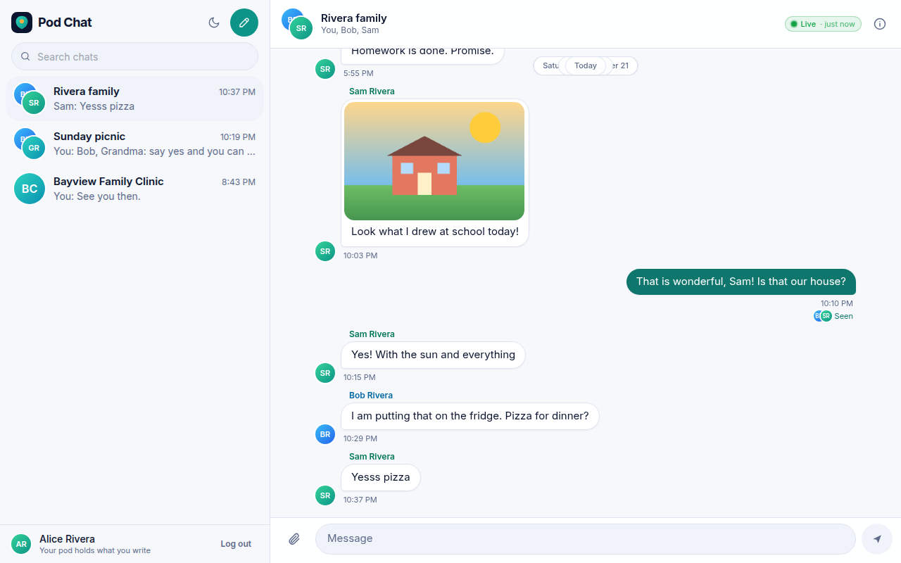

# Pod Chat

Chat done right: **every message lives in its author's own Solid pod.** Nobody hosts the conversation. Each
participant writes only into their own pod and grants the other participants Read. The app stitches the pods
together while you read, and leaving a conversation revokes your grants, so your words disappear for everyone else.

Part of the SKPods showcase (`showcase/`). Dev port **5176**.



## The story

* **Family chat** (Alice, Bob and Sam, the kid) with a week of history, a photo, read receipts and an unread badge.
* **Business chat** between Alice and Bayview Family Clinic, a 1:1 conversation.
* **Invitation**: Alice started "Sunday picnic" and invited Bob and Grandma. Log in as Bob and tap Join.
* **The sovereign moment**: open a chat, tap the info button, switch on *Pod view* (every bubble shows the pod and
  file it comes from), then *Leave conversation*. Your messages stay in your pod, access is revoked, and on the
  others' screens they dissolve. Rejoin and they return.

## How it works

```
alice's pod                          bob's pod
/skpods/v1/chat/c-ab12/              /skpods/v1/chat/c-ab12/
  .acl        owner + Read: bob        .acl        owner + Read: alice
  conversation.ttl   (mirror)          conversation.ttl   (mirror)
  m-<id>.ttl         alice's messages  m-<id>.ttl         bob's messages
  s-<from>-<to>-<t>.ttl  archive       r-<id>.ttl         bob read up to <id>
  e-<id>-<ms>.ttl    an edit           left.ttl           (only after leaving)
  a-<id>.jpg         a photo
  r-<id>.ttl         alice read up to <id>
/skpods/v1/chat-inbox/    owner + Append: contacts   (invitations land here)
```

* **One writer per resource.** The engine has no ETag and ignores `If-Match`, so two writers on one file would
  silently overwrite each other. Here nobody ever shares a file.
* **Files are immutable, state change = a new or a removed file name.** An edit is a new `e-` file, a read receipt is
  a new `r-` file (older ones are pruned), a delete removes the file. So the only thing to poll is a container
  *listing*, one GET per author, and fetched bodies are cached forever by URL (IndexedDB).
* **Archives for fast first load.** A GET takes about 300 to 450 ms on pods-dev and they are served roughly one at a
  time, so 100 messages as 100 files would take 30 seconds. Old loose messages (older than 2 hours, never edited, 12 or
  more) are rolled up by their author's client into one `s-` file. Readers de-duplicate by message id, so the switch
  is invisible. Deleting a message inside an archive rewrites that archive.
* **Merge.** The client reads every participant's container, merges by send time (id = epoch ms plus a random tail),
  and only accepts a message in an author's pod if its `schema:author` is that pod's owner.
* **Live updates.** Polling always works on its own, and the optional relay makes it fast. See *Live updates* below.
* **Optimistic send.** A message shows at once (clock icon), is PUT to your pod, then confirmed. Failed sends show
  Retry and Discard.
* **Read receipts** (a tiny file in the reader's pod) and *Seen* avatars under your latest read message.
* **Attachments.** Photos are resized in the browser (long side 1600 px, JPEG) and stored as `a-<id>.jpg` in your pod;
  the container ACL shares them with the chat. They are fetched with the DPoP token and shown as blob URLs.
* **Invitations.** Creating a chat POSTs a small invitation into each invitee's inbox. The inbox is **Append-only**
  for the invitee's contacts, so a stranger cannot read it or see who else was invited. Joining writes your container,
  your mirror of the descriptor and an ACL granting the other participants Read. The invitation must point into the
  sender's own chat folder (anything else is ignored).
* **Leaving** writes `left.ttl` with its own ACL (the one thing that stays readable, so others learn why you went
  quiet), then rewrites the container ACL to owner only. The pod then answers 403 for everyone else. Rejoin restores
  the grants. *Erase my copy* really deletes your messages.
* **Pod view**: toggle in the info panel, tags each bubble with `~pod / file`.

## Live updates

* **Polling, always.** The pod engine has no notifications browsers can reach (see ENGINE-NOTES.md), so Pod Chat polls:
  the open chat every 2 s, backing off by 1.4x to 12 s while quiet, other chats every 12 s up to 45 s, paused while the
  tab is hidden, reset on send and on focus. The header badge says *Live* and, on hover, how often it looks.
* **Push hints, optional.** With `VITE_RELAY_URL` set, the client also talks to the SKPods relay
  ([`docs/CHAT-PROTOCOL.md`](../../../docs/CHAT-PROTOCOL.md)). Each new conversation carries a random relay room id in its
  descriptor. After every write the author's client sends the room a ping that says only "something changed at URL X";
  the others re-read that conversation from the pods at once. Someone who was offline gets the pings from their mailbox
  when they reconnect. The relay never sees message text, titles or files, and a ping is only a hint: the client
  still trusts nothing but what the pods return.
* **Slower polling while live.** While a conversation's relay room socket is up, its badge says *Live (push)* and its polling slows to
  15 s (open chat) and 30 s (others), up to 60 s and 120 s, as a safety net. If the relay is unset, refuses the login or
  goes down, polling drops straight back to the normal pace above. Conversations created before the relay (no room id
  in their descriptor) simply keep polling.
* **Measured.** Against pods-dev with a local relay, a message reached the other person's engine about 1 to 1.2 s
  after the author's PUT finished, with that engine on the slow relay timing (so polling alone would need 15 s or more).

Vocabulary: `schema:Message`, `schema:text`, `schema:author`, `schema:dateCreated`, `schema:image` plus a few `skp:`
terms in [`../../vocab/pod-chat.ttl`](../../vocab/pod-chat.ttl).

## Run it

```bash
cd showcase && npm install
# credentials for the pods-dev test users (never committed): a file with SKPODS_BASE and DW_<USER>_USER/_PASSWORD,
# optionally DW_<USER>_CLIENT_ID/_SECRET (minted from the password when missing)
export SKP_TEST_ENV=/path/to/pods-dev-test.env:/path/to/dw-clients.env

npm run dev  -w @skpods/pod-chat          # http://localhost:5176/  (port is fixed: the OIDC redirect URI is registered)
npm run demo -w @skpods/pod-chat          # in a second terminal: seed the family chat, clinic chat and picnic invitation (about 35 s),
                                          # then sign each demo user in once so their pod trusts the app origin (see below)
```

**Why the sign-in step.** pods-dev only answers a request that carries `Origin: http://localhost:5176` for a pod whose
owner has signed in to that origin once and pressed *Allow*. Until then every private read of that pod answers `403`,
even for people its ACL names. So in a real chat a person's messages reach the others only after they have used the
app once, and Pod Chat shows such a person as *Not sharing* (info panel). `npm run demo` automates the one-time
sign-in for the cast with Playwright (`npm run demo:authorise` repeats just that step, it needs the dev server up).

Log in as `dw-alice` (family and clinic chats), `dw-bob` (family chat and the picnic invitation) or `dw-kid`. One
browser profile holds one login, so use two profiles (or a private window) to watch both sides.
`npm run demo:clean -w @skpods/pod-chat` removes the demo conversations again.

Contacts: the demo cast (`VITE_DEMO_CAST`, default the dw-* users) plus anyone you add by WebID. Invitations only
reach people whose pod accepts your WebID in its chat inbox (they must have opened Pod Chat once, which sets it up).

Relay (optional): set `VITE_RELAY_URL` (for example `wss://relay.example`) to receive "something changed" pings from
the SKPods relay (`docs/CHAT-PROTOCOL.md`). While it is live the badge says *Live (push)* and polling slows down; if
the relay is unset or down, Pod Chat polls exactly as before. To try it locally, run the relay with
`npx wrangler dev --port 8787` in a skpods-relay checkout and start the app with
`VITE_RELAY_URL=ws://127.0.0.1:8787 npm run dev -w @skpods/pod-chat`.

### Tests

```bash
npm test -w @skpods/pod-chat                      # unit: codec, merge, layout, backoff, compaction picks, relay client and wiring
npm run test:integration -w @skpods/pod-chat      # engine against pods-dev, headless (5 tests, about 4 min)
npm run test:e2e -w @skpods/pod-chat              # two real browsers through the Nextcloud login form (8 tests, about 4 min)
# SKP_ORIGIN=http://localhost:5176 makes the headless suite send the browser's Origin header on every request

# relay suite: also needs a local relay from the skpods-relay repo (Rust, wrangler); 3 more tests, about 1.5 min
npx wrangler dev --port 8787                                       # terminal 1, in a skpods-relay checkout
SKP_RELAY_URL=ws://127.0.0.1:8787 npm run test:integration -w @skpods/pod-chat   # terminal 2, in showcase/
```

Without `SKP_RELAY_URL` the 3 relay tests are skipped.

The integration suite proves, with real pods and real ACLs: the seeded history merges from three pods in order;
invitation, join and first message; photo stored in the author's pod and fetchable by the reader; read receipt; edit;
delete; leave (403 on the container, 200 on `left.ttl`, ghosts and system line on the reader); rejoin; archive
rollup with no gap, and delete inside an archive; and a non-participant gets 403. With `SKP_RELAY_URL` it also proves,
through a real relay and real DPoP-bound tokens: a message reaches the other engine by push within 3 s while its
polling is on the slow relay timing; an offline member gets the ping from their mailbox on reconnect; and a proof made
for one relay URL is refused (close 4401) on another, while the right proof is admitted.
The e2e suite drives the same story through the UI and saves the screenshots below.

## Real vs mocked

| Real against pods-dev | Not done or mocked |
|---|---|
| Browser Solid-OIDC login (code + PKCE + DPoP), refresh | No Solid notifications: the engine's WebSocket source URL is in-cluster, unreachable from browsers. Push comes only from the optional SKPods relay, and no public relay is deployed yet, so without `VITE_RELAY_URL` it is polling only |
| Push hints through the SKPods relay, proven with a local `wrangler dev` relay and real pods-dev tokens | |
| Every read and write, ACLs, Append-only inbox, photos | The demo cast and their display names are a built-in directory for the dw-* test pods |
| Seed script through the agent flow | Leaving is cooperative for people who already read your messages: they may have copied them, and the engine cannot revoke that. The others' grants to the leaver are not revoked automatically |
| | No reactions, replies, search inside a chat, typing indicators (by design), end-to-end encryption (pods are the access boundary, the server can read files) |
| | Clock skew between participants shifts ordering a little: ordering uses each sender's clock |

## Engine limits we hit (pods-dev)

* **App origin must be authorised by every pod owner.** Request: any `GET` of a private resource with header
  `Origin: http://localhost:5176` in `dw-kid`'s pod, as its owner, answered `403` before the first browser sign-in
  and `200` after; the same request without `Origin` answered `200`. Alice's browser reading a container in Kid's
  pod (`skpods/v1/chat/demo-family/`) answered `403` until then (Bob's, who had signed in, answered `200`).
  Agent logins send no `Origin`, so the headless suites do not notice (`SKP_ORIGIN` reproduces it). Writing to a
  recipient's invitation inbox is blocked the same way: that is the "has not opened Pod Chat yet" invitation error.
* **403 for "does not exist"** and for "exists but not yours" alike: `GET` of a missing container, and of a container
  whose ACL excludes you, both answer 403. So "has not joined yet" and "left without a notice" look the same; the
  separate readable `left.ttl` is how a deliberate leave is told apart.
* **~300 to 450 ms per request and effectively serial**: ten parallel GETs took about 3 s. This is why archives exist.
* **No ETag / If-Match**, **no notifications**, **PATCH quirks**: avoided by design (single writer, new files, PUT).
* **HEAD answers 204 for everything**: existence is checked with GET.
* Content type follows the extension on read: attachments are stored as `a-<id>.jpg` / `.png`.
* A resource ACL overrides the container ACL as expected, which is what keeps `left.ttl` readable after the container
  grants are revoked (`GET` on it answers 200 while the container answers 403).

## Proposed library changes (not made: other agents own `packages/*`)

* `PodStore.listWithStatus(container)` returning `{status, children}`, since callers need the 403 and 404
  distinction that `list()` hides.
* `watchContainer(store, url, onChange)` next to `watchResource`: poll a listing, compare the child URL set. Pod Chat
  has its own per-conversation scheduler with per-conversation backoff; the container watcher is the reusable part.
* An `agentLogin` re-export from the main `@skpods/solid-web` entry (it is only on `/node`).
