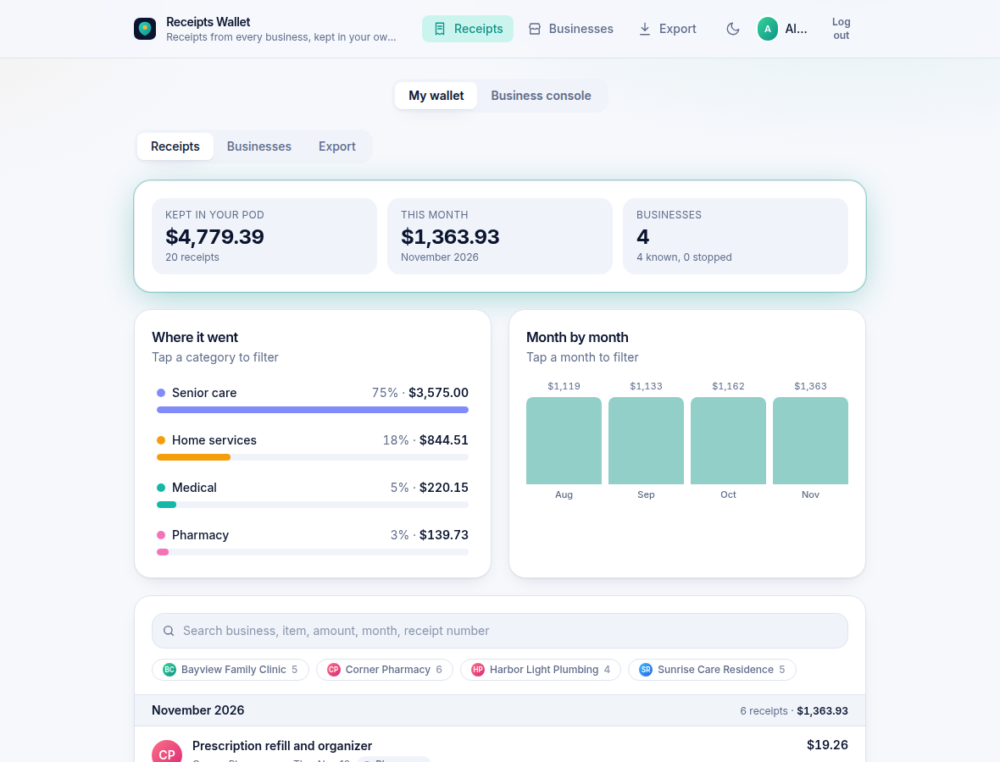
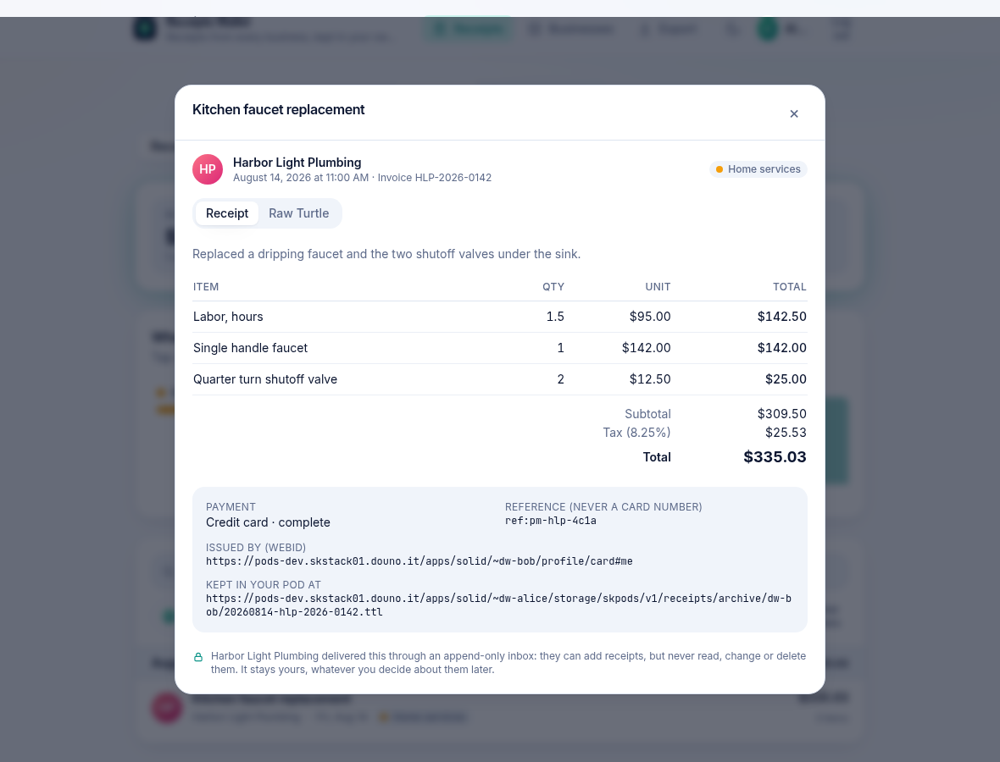
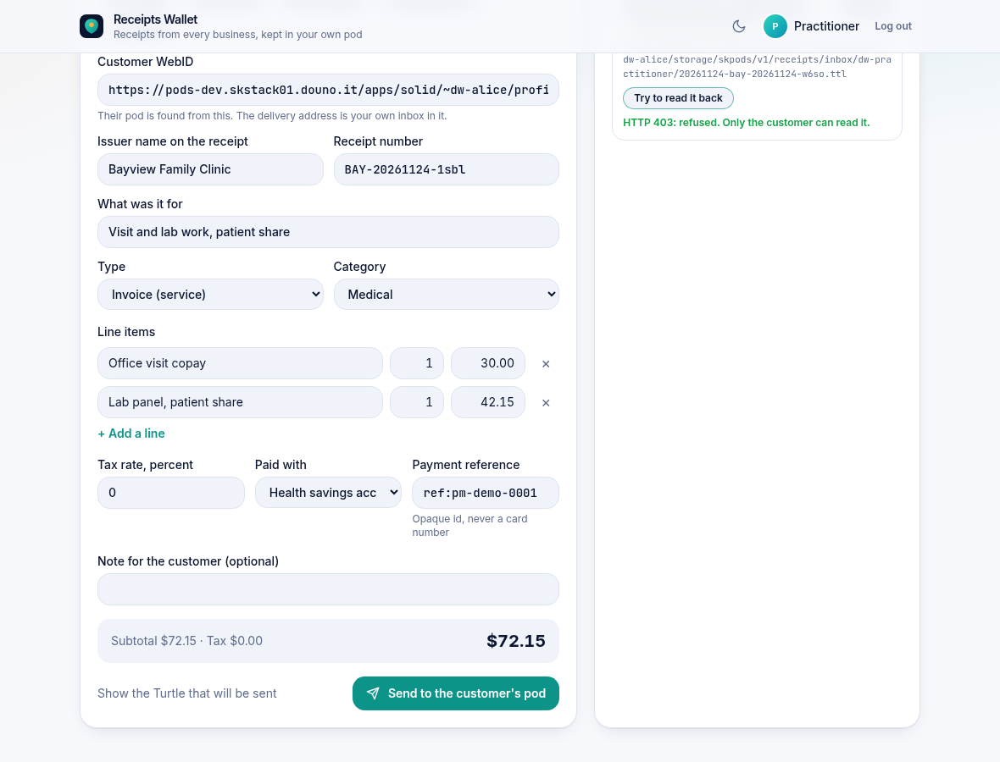
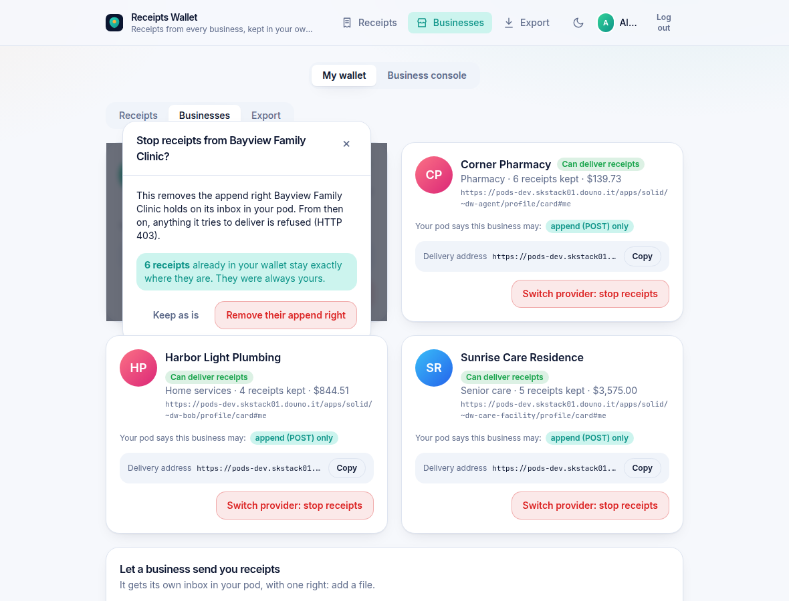

# Receipts Wallet

Every business you use drops receipts into **your** pod, and you keep them forever.

A clinic copay, a plumber's invoice, a month of day care, a pharmacy order: each business is allowed to *add* a receipt to
your pod and nothing else. It cannot read it back, list your other receipts, change or delete anything. Switch providers
and the old receipts stay exactly where they are, because they were never the business's to keep. Search them, total them
by category and month, export them for taxes. No database, no account with the wallet: the pod is the storage.

| | |
|---|---|
|  |  |
|  |  |

More: raw Turtle (`04`), filters (`05`), export (`06`), live arrival toast (`09`), businesses and their ACL (`10`), refused delivery
after switching (`12`), phone width (`13` to `16`).

## The story, step by step

1. **Set up.** On first login the wallet creates `skpods/v1/receipts/` in the pod with an explicit owner-only ACL, plus
   `inbox/`, `archive/` and `businesses/`.
2. **Allow a business.** "Allow this business" creates `inbox/<business>/` and writes an ACL that names that one WebID
   with **Append** (`acl:agent`, with `acl:default`) and keeps the owner in full control. One container per business means the
   container a receipt is found in tells you who could have written it.
3. **Business console.** Log in as `dw-practitioner` or `dw-care-facility` (or run the demo script with their client
   credentials), pick *Business console*, fill in a receipt and send. It is one `POST` of a Turtle document into the
   customer's inbox for that business. The console then offers "Try to read it back": the pod answers **403**.
4. **The wallet files it.** The customer's open wallet polls the inboxes (the engine has no usable notifications), copies new
   receipts into `archive/<business>/` and removes them from the inbox, with a toast.
5. **Browse.** Timeline by month, business chips, totals per category, month bars (tap to filter), free text search over
   business, item, receipt number, amount and month, receipt detail with the **raw Turtle** exactly as delivered.
6. **Switch provider.** "Stop receipts" removes the business's rule from the inbox ACL. Its next `POST` is refused (403).
   The archive is untouched. "Allow receipts again" puts the rule back.
7. **Export.** Receipts CSV, line items CSV and a zip of the raw RDF files, built in the browser (the zip writer is 60 lines
   in `src/lib/zip.ts`, no dependency). The current filter can be exported instead of everything.

## Pod layout

```
<storage>/skpods/v1/receipts/            owner only, ACL with acl:default
  inbox/<business>/                      ACL: owner Read Write Control, business Append (acl:agent)
  archive/<business>/<yyyymmdd>-<id>.ttl the receipts you keep
  businesses/<business>.ttl              who you allowed (name, WebID, category, status)
```

A receipt is `schema:Invoice` (services) or `schema:Order` (goods) with `schema:OrderItem` lines, subtotal, tax rate, tax,
`schema:totalPaymentDue`, the issuer as `schema:provider` and a payment **method label and opaque reference**
(`schema:paymentMethod`, `schema:paymentMethodId`). Never a card number: the builder rejects anything that looks like one
(13 to 19 digits passing Luhn) in any text field. Terms that schema.org lacks (`skp:subtotal`, `skp:taxRate`, `skp:taxTotal`,
`skp:lineTotal`, `skp:ReceiptIssuer`, `skp:inboxKey`, `skp:status`, `skp:stoppedAt`) are in `../../vocab/receipts.ttl`.

## Run it

```bash
cd showcase && npm install
npm run dev -w @skpods/receipts-wallet          # http://localhost:5175  (fixed port, registered redirect URI)
```

Log in with the pod provider (default `https://pods-dev.skstack01.douno.it`, override with `VITE_POD_ISSUER`).

### Demo seed and scripts

The scripts use the headless agent flow (client credentials with DPoP). Point `SKP_TEST_ENV` at env files that define
`SKPODS_BASE` and, per account, `DW_<NAME>_USER` plus either `DW_<NAME>_CLIENT_ID` / `_CLIENT_SECRET` or `DW_<NAME>_PASSWORD`.
Nothing is printed or committed.

```bash
export SKP_TEST_ENV=/path/pods-dev-test.env:/path/dw-clients.env
npm run demo:seed -w @skpods/receipts-wallet         # reset dw-alice's wallet, allow 4 businesses, deliver 20 receipts
npx tsx scripts/demo.ts issue --as bayview --amount 40   # one live receipt (watch the open wallet pick it up)
npx tsx scripts/demo.ts stop bayview                     # alice switches provider
npx tsx scripts/demo.ts reset
```

The seed delivers **20 fake receipts, Aug to Nov 2026**, from four fake businesses: Bayview Family Clinic (copays and labs),
Sunrise Care Residence (monthly day care, therapy), Harbor Light Plumbing, Corner Pharmacy. pods-dev has only a few test
accounts, so the plumber is played by `dw-bob` and the pharmacy by `dw-agent`; the clinic and care facility are
`dw-practitioner` and `dw-care-facility`. Receipts are left in the inbox so the wallet shows the filing step; add `--file` to
file them from the script.

### Tests

```bash
npm test -w @skpods/receipts-wallet            # unit: Turtle build/parse round trip, card number guard, filters, CSV, zip
npm run test:e2e -w @skpods/receipts-wallet    # real browser against pods-dev (needs SKP_TEST_ENV), ~3 minutes
```

The e2e test reseeds dw-alice, drives the **Nextcloud login form** for dw-alice and for dw-practitioner (separate browser
contexts), and asserts: 20 receipts across 4 businesses, inbox empty and archive filled, search and category filters, raw
Turtle without any card number, CSV with 21 lines and a zip with 21 entries, console delivery then **403 on read-back**,
live arrival in Alice's open wallet, then at protocol level as the business: **403 on GET, list, DELETE, PUT-overwrite**, 403 when
posting into another business's inbox and 403 on the archive; then switching provider (delivery now 403, 6 old receipts
still in the archive and the timeline), resuming, and the phone layout (no horizontal overflow). Screenshots are written to
`docs/screenshots/`.

## What is real, what is not

| | |
|---|---|
| Real | Browser Solid-OIDC login (code + PKCE + DPoP), every read and write against pods-dev, the ACLs (written with `writeAcl`, read back to show the business's actual rights), Append-only POST, filing, polling, the console, export |
| Real | Per-business provenance by container; per-business isolation (verified 403 into someone else's inbox) |
| Mocked | The businesses. Four fake businesses played by test accounts; receipts are fake data |
| Not done | Payment integrations, signing receipts (a receipt is as trustworthy as the container it arrived in), notifications (polling every 7 s while the tab is visible), pagination of very large archives (everything is read once and cached in memory) |
| Untested | Other Solid servers: only pods-dev behaviour was exercised |

## Engine limits hit (pods-dev)

- **An appender cannot ask "may I?".** `HEAD` and `GET` on the inbox as the business answer `403` and carry no `WAC-Allow`
  header, so the console cannot show a green light before sending. It learns by trying: `POST` is `201`, or `403` (not
  added, or stopped), or `404` (no inbox).
- **Transient 500.** Under parallel load the engine sometimes answers `500` with a Nextcloud HTML error page, for example
  `POST .../receipts/inbox/dw-practitioner/` while four businesses were delivering at once, and some `GET`s while the wallet
  listed many containers. `src/lib/resilient.ts` retries idempotent requests with backoff; `POST` is never retried by the
  app (a repeat could duplicate a receipt) and the seed script retries it explicitly. The wallet also caps its own concurrency.
- **A delete can lag.** Once a listing of the inbox still showed a document right after the wallet deleted it. The next
  load removes leftovers that already exist in the archive, so it self-heals.
- **No author on resources.** The engine records no creator, so there is no way to prove which agent wrote a file. Hence one
  inbox container per business: the ACL is the provenance.
- Seeded profile names carry a trailing "(... test)" note; the app shows the plain name.
- Everything in `packages/solid-web/ENGINE-NOTES.md` applies: no ETag, always `.ttl`, per-triple N3 patches (the wallet
  never patches, it writes whole small documents), 403 not 401.

## Proposed library changes (not made, other agents own `packages/`)

- `ResilientStore` (retry idempotent requests on 5xx or 429) belongs in `@skpods/solid-web` as a `PodStore` option.
- `Modal`, `Chip` and a copy button are generic and would fit `@skpods/ui`.
- `PodStore.list` returns only URLs, so each receipt needs its own `GET`. A server that sent types or dates in listings
  would make the timeline cheaper; today a cache keyed by URL (receipts are immutable) is the mitigation.
